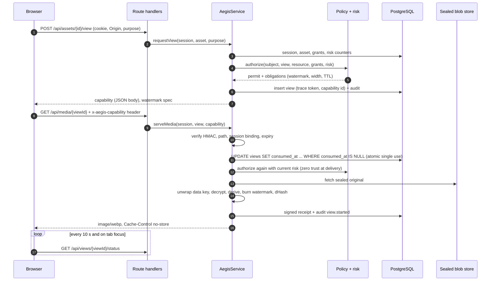

# Aegis Glass: architecture, threat model, and operating plan

Aegis Glass is the server-enforced layer behind ClearGlass's protected viewing. It decides who may see a confidential image, serves each person a one-time watermarked copy, and keeps a tamper-evident record that ties any leaked copy back to the view it came from.

It uses public, auditable building blocks only: OAuth/OIDC-style sessions, HMAC-SHA256, AES-256-GCM envelope encryption, Ed25519 signatures, SHA-256 hash chains, PostgreSQL, and libvips. No classified or agency technology is involved or claimed.

## What this layer cannot do

**Content shown on a screen the user controls cannot be protected from photography or screenshots.** No web application can reliably detect or block an operating-system screenshot, a second device's camera, or a modified browser. The copy, drag, context-menu, and print controls here are friction only.

What Aegis Glass makes true instead:

1. A person sees an image only after policy says yes, and only once per grant of a single-use capability.
2. Every copy they see carries their pseudonym and a trace token, both burned into the pixels and overlaid in the page.
3. Every decision, permit or refusal, lands in an append-only, hash-chained, signed audit trail.
4. When a copy leaks, an investigator can verify the token cryptographically and resolve it to the exact view, session, and person. That resolution is itself audited.

## Status of each part

Status labels: **Implemented** (code exists) · **Tested** (automated tests pass) · **Connected** (wired to a real external service) · **Production verified** (running in production) · **Blocked** (needs an external decision or service).

| Area | Status | Evidence |
|---|---|---|
| Policy decision point (tenant isolation, ABAC + RBAC, JIT grants, purpose binding, step-up) | Implemented, Tested | `src/lib/policy.ts`, `tests/policy.test.ts` |
| Single-use, session-bound, header-borne media capabilities | Implemented, Tested | `src/lib/capability.ts`, `tests/journey.test.ts`, `tests/postgres.test.ts` (1 of 8 concurrent spends wins) |
| Envelope encryption of originals (per-asset data key, KEK wrap, AAD binding, rotation) | Implemented, Tested | `src/lib/envelope.ts`, `tests/primitives.test.ts` |
| Per-view derivatives: resize by risk, burned-in watermark, metadata stripped | Implemented, Tested | `src/lib/image.ts`, `tests/journey.test.ts` |
| Rotating overlay watermark, revocation polling, browser risk signals | Implemented, Tested in a real browser | `src/components/SecureAssetViewer.tsx`, Playwright run (19/19 checks; not yet in CI) |
| Explainable risk engine and deterministic responses | Implemented, Tested | `src/lib/risk.ts`, `tests/journey.test.ts` |
| Honey (canary) assets and human-review incidents | Implemented, Tested | `src/lib/service.ts`, `tests/journey.test.ts` |
| Signed view receipts | Implemented, Tested | `src/lib/service.ts`, `tests/journey.test.ts`, `tests/forensics.test.ts` |
| Leak intake: trace verification + perceptual hash, three confidence levels | Implemented, Tested | `tests/forensics.test.ts` |
| Hash-chained audit, signed checkpoints, DB-enforced append-only | Implemented, Tested (PGlite and PostgreSQL 16) | `src/lib/audit.ts`, `db/migrations/001_aegis_glass.sql`, `tests/forensics.test.ts`, `tests/postgres.test.ts` |
| Security headers, nonce CSP, CSRF origin checks, rate limits | Implemented, Tested | `src/middleware.ts`, `src/lib/headers.ts`, `src/lib/http.ts`, `tests/routes.test.ts` |
| PostgreSQL server adapter | Implemented, Tested against a local PostgreSQL 16 | `src/lib/db.ts`, `tests/postgres.test.ts` |
| Production sign-in (OIDC with MFA / passkeys) | **Blocked**: adapter not written; production start refuses to run | `src/lib/config.ts` |
| KMS/HSM key wrapping | **Blocked**: interface only (`KeyWrapper`) | `src/lib/envelope.ts` |
| Private object storage (S3-compatible) | **Blocked**: interface only (`BlobStore`); filesystem store used in dev/CI | `src/lib/blobstore.ts` |
| Shared rate limits across instances (Redis or Postgres) | Designed, not implemented (per-process limiter today) | `src/lib/http.ts` |
| Retention and deletion jobs, legal hold | Designed, not implemented | See "Retention" below |
| Network risk feeds (new device, impossible travel, ASN reputation) | Interface only; defaults to "no signal" | `ServiceDeps.networkSignals` |
| Per-viewer invisible forensic watermark | Not implemented (stage 4; vendor and legal review) | See rollout |

## 1. System architecture

```mermaid
flowchart LR
  subgraph Browser["Browser (untrusted)"]
    UI["Workspace + SecureAssetViewer"]
  end
  subgraph Edge["Next.js edge"]
    MW["middleware.ts<br/>nonce CSP, HSTS, frame denial"]
  end
  subgraph App["Next.js server (Node runtime)"]
    RH["Route handlers<br/>origin check, zod, rate limit"]
    SVC["AegisService<br/>journey orchestration"]
    PDP["Policy decision point<br/>policy.ts"]
    RISK["Risk engine<br/>risk.ts"]
    CAP["Capabilities<br/>capability.ts"]
    IMG["Derivation<br/>image.ts (libvips)"]
    AUD["Audit chain<br/>audit.ts"]
  end
  subgraph Data["Private data plane"]
    PG[("PostgreSQL<br/>append-only triggers")]
    BLOB[("Sealed blobs<br/>AES-256-GCM")]
    KMS["KEK holder<br/>(KMS in production)"]
  end
  IDP["Identity provider<br/>(OIDC, MFA, passkeys)"]

  UI -->|HTTPS| MW --> RH --> SVC
  SVC --> PDP
  SVC --> RISK
  SVC --> CAP
  SVC --> IMG
  SVC --> AUD --> PG
  SVC --> PG
  SVC --> BLOB
  SVC --> KMS
  IDP -.->|sessions (blocked: adapter)| RH
```

## 2. Data flow and trust boundaries



Trust boundaries:

| # | Boundary | What crosses it | Controls at the boundary |
|---|---|---|---|
| TB1 | Browser to edge | All requests | TLS + HSTS (production), nonce CSP, `frame-ancestors 'none'`, `Permissions-Policy` |
| TB2 | Edge to route handler | Cookies, JSON, multipart | Signed session cookie (HttpOnly, SameSite=Strict, `__Host-` on https); Origin/Fetch-Metadata check; zod validation; rate limits |
| TB3 | Route handler to service | Typed calls | Server-side session lookup on every call; revocation and pause take effect immediately |
| TB4 | Service to database | Parameterised SQL | No string-built SQL; append-only triggers; atomic capability consumption |
| TB5 | Service to blob store | Sealed bytes only | AES-256-GCM with per-asset data key; AAD binds tenant + asset; key ids validated |
| TB6 | Service to key holder | Data keys to wrap/unwrap | KEKs never leave the holder in production (KMS); local wrapper only in dev/CI |
| TB7 | Upload parser | Untrusted image bytes | Size, format, dimension, and pixel limits; libvips kept patched (sharp 0.35.5) |
| TB8 | Client risk signals | Untrusted claims | Only raise risk, never lower it; rate limited; logged as `client_untrusted` |

## 3. Threat model

**What is protected:** confidential originals; derived previews; trace-token to person mapping; signing and HMAC keys; KEKs; the audit trail; incident cases.

**Attackers considered:**

- An authorised user who leaks by photographing, screen-recording, or exporting.
- A malicious insider with database or storage access.
- An attacker holding a stolen cookie or a taken-over account.
- An automated scraper or OCR harvester.
- An attacker replaying captured URLs or tokens.
- A tenant trying to reach another tenant's data.
- A compromised browser extension.
- A supply-chain compromise.

### STRIDE

| Threat | Example | Primary controls | Residual risk |
|---|---|---|---|
| **S**poofing | Stolen session cookie used from another browser | HttpOnly + SameSite=Strict cookie; server-side sessions; capability bound to session; step-up for RESTRICTED+; immediate revocation | A cookie stolen by malware on the victim's own device works until revoked or expired; device binding (DPoP or similar) is stage 3 |
| **T**ampering | Edit audit rows to hide a view | Triggers refuse UPDATE/DELETE/TRUNCATE; SHA-256 chain; Ed25519 checkpoints | A database superuser can drop triggers; checkpoints then expose the edit, but only if checkpoint keys and copies are held separately from DB admins |
| **T**ampering | Swap one asset's ciphertext for another's | AAD binds tenant + asset at both encryption layers | None known |
| **R**epudiation | "I never opened that file" | Signed view receipt per served view; audit chain; trace token in pixels | Shared accounts defeat attribution; policy must forbid them |
| **I**nformation disclosure | Signed-URL leakage via logs, history, or Referer | Capability travels in a header, never a URL; single use; 60 to 300 s TTL; `Referrer-Policy: no-referrer` | None for the URL path; a captured header is useless without the session cookie |
| **I**nformation disclosure | Cache exposure | `Cache-Control: no-store, private`; `Pragma: no-cache`; blob URLs revoked on close | Pixels already displayed can be captured; see the warning above |
| **I**nformation disclosure | Cross-tenant read | Tenant check first in policy; identical 404 for "other tenant" and "missing" | Bugs outside the policy layer; covered by tests, not by proof |
| **I**nformation disclosure | Stored originals read from disk or bucket | Only sealed bytes stored; KEK held elsewhere | Dev/CI KEKs are in process memory; production needs KMS |
| **D**enial of service | Bulk view requests; image bombs | Per-session rate limits; risk escalation on view rate; pixel and size limits | Per-process limits only until a shared store exists |
| **E**levation of privilege | Member plants honey asset or runs leak intake | Role checks in service; honey uploads need investigator; intake needs investigator | Role assignment happens in the IdP, outside this layer |
| **E**levation of privilege | Prompted step-up reveals that a restricted asset exists | Entitlement is checked before authentication strength | None known |

### Control matrix

| Threat | Prevent | Detect | Respond | Evidence | Residual |
|---|---|---|---|---|---|
| Authorised user photographs the screen | Watermark density and rotation by classification and risk | Leak intake (token + perceptual hash) | Human-reviewed case; revoke grants | Receipt, audit chain, trace record | Cannot be prevented, only attributed |
| Screen recording / automation | `display-capture=()`; automation signal | `navigator.webdriver`, view rate, bulk access | Densify, downgrade, step-up, pause | `risk.state_changed` with contributions | Modified browsers suppress signals |
| Cropping out the watermark | Tiles across the whole image, re-laid every 10 to 30 s; burned-in copy | Perceptual match (asset-level) | Case | Derivative hash per view | Heavy crops fall outside dHash tolerance |
| Account takeover | Step-up, short TTLs, risk signals | Impossible-travel / new-device feeds (integration point) | Pause session at CRITICAL | Session and risk events | Feeds not connected yet |
| Insider with DB access | Append-only triggers; KEK outside DB | Chain verification; checkpoint mismatch | Incident | Signed checkpoints | Superuser can drop triggers; keep checkpoint copies off-database |
| Replay of a capability | Atomic single use; session binding; expiry | `view.capability_rejected` | Risk points (failed authorisation) | Audit | None known |
| Canary exfiltration | Honey assets look ordinary | `honey.accessed` | Human-review case, no automatic accusation | Audit + receipt | Legal review needed before use |

## 4. Critical paths in code

| Path | File |
|---|---|
| Authorisation | `src/lib/policy.ts` (`authorize`) |
| View request and media delivery | `src/lib/service.ts` (`requestView`, `serveMedia`) |
| Capability format and checks | `src/lib/capability.ts` |
| Trace tokens and pseudonyms | `src/lib/trace.ts` |
| Watermark text, layout, SVG | `src/lib/watermark.ts` (shared by server and browser) |
| Derivation and perceptual hash | `src/lib/image.ts` |
| Envelope encryption | `src/lib/envelope.ts` |
| Audit chain | `src/lib/audit.ts`, `AegisStore.appendAudit` |
| Viewer | `src/components/SecureAssetViewer.tsx` |
| Headers | `src/middleware.ts`, `src/lib/headers.ts` |
| Configuration (fail closed) | `src/lib/config.ts` |

## 5. Data model and event taxonomy

Schema: `db/migrations/001_aegis_glass.sql`. The schema holds:

- **Tables:** tenants, users (ids and roles only, no emails), sessions, assets, grants, views (trace records), view_receipts, risk_events, incidents, audit_events, audit_chain_head, and audit_checkpoints.
- **Enforced in the database:** classification and role enums, the "exactly one subject and one scope" rule for grants, trace-token format, and append-only triggers.

Audit event types:

| Type | Severity | When |
|---|---|---|
| `auth.session_created` / `auth.session_revoked` / `auth.session_paused` | info / notice / critical | Session lifecycle |
| `auth.step_up_required` | notice | Policy asked for stronger sign-in |
| `authz.deny` | warning | Any refusal, including tenant isolation |
| `asset.registered` / `asset.revoked` | info / notice | Asset lifecycle (honey flag recorded here) |
| `grant.created` | notice | Entitlement issued |
| `view.capability_issued` | info | Permit, with obligations and risk score |
| `view.capability_rejected` | warning | Bad signature, expiry, replay, wrong session, policy changed |
| `view.started` | info | Media served; receipt id and derivative hash |
| `risk.signal_recorded` / `risk.state_changed` | info / notice to critical | Signals and transitions, with contributions |
| `honey.accessed` | critical | Canary opened by a non-investigator |
| `incident.opened` | warning / critical | Always `needs_human_review` |
| `leak.intake_submitted` / `leak.trace_resolved` | warning | Forensics, including who resolved a pseudonym |
| `audit.verified` | info / critical | Chain verification result |

Never written to the audit trail: email addresses, IP addresses, passwords, cookies, authorisation headers, capability tokens. `redact()` strips these keys.

## 6. Risk engine

| Signal | Points | Source |
|---|---|---|
| New device | 15 | IdP / edge (integration point) |
| Impossible travel | 40 | IdP / edge (integration point) |
| Bad ASN reputation | 20 | Edge feed (integration point) |
| Session older than 12 h | 10 | Server |
| Denied requests, 15 min | 8 each, max 32 | Server |
| View requests per minute > 20 / > 60 | 20 / 40 | Server |
| > 15 distinct assets in 5 min | 25 | Server |
| Hidden / unfocused view | 2 each, max 10 | Browser (untrusted) |
| Developer-tools heuristic | 10 | Browser (untrusted; false positives) |
| Automation (`navigator.webdriver`) | 35 | Browser (untrusted) |
| Rapid navigation | 5 each, max 15 | Browser |
| Print / copy / context menu | 10 (max 20) / 3 (max 12) / 1 (max 5) | Browser |

How a score becomes a state, and what each state triggers:

| State | Score | Response |
|---|---|---|
| LOW | under 20 | None |
| GUARDED | 20 to 44 | Denser watermark |
| HIGH | 45 to 69 | Denser watermark, lower resolution, fresh sign-in required for CONFIDENTIAL and above |
| CRITICAL | 70 and over | Pause the session, revoke its open views, open a case for human review |

Every response is reversible: re-authenticating clears a pause.

The engine never uses biometrics, keystroke or mouse dynamics, or inference about the person.

## 7. Rollout

| Stage | Scope | Exit criteria |
|---|---|---|
| 1. Foundation | Deploy to a staging tenant with OIDC adapter, KMS wrapper, private bucket, managed PostgreSQL. INTERNAL and CONFIDENTIAL only. | All CI gates green; production config loads; chain verifies daily; restore drill passes |
| 2. Controlled pilot | One team, RESTRICTED enabled, risk engine in observe-only for 2 weeks (log responses, do not pause) | False-pause rate under 1 % of sessions; median view latency under 800 ms; no accessibility regressions |
| 3. Adaptive defense | Enable pauses; connect network risk feeds; shared rate limits; device-bound sessions | Pauses reviewed within one business day; no unreviewed CRITICAL cases |
| 4. Forensic operations | Honey assets (after legal sign-off); investigator runbook; optional invisible forensic watermark vendor | Leak-intake drill traces a planted copy end to end |

## 8. Test plan

| Area | Automated | File |
|---|---|---|
| Authorisation bypass, tenant isolation | Yes | `policy.test.ts`, `journey.test.ts`, `routes.test.ts` |
| URL / capability leakage, replay, cross-session | Yes | `journey.test.ts`, `routes.test.ts`, `postgres.test.ts` |
| Caching headers | Yes | `routes.test.ts` |
| Watermark attribution | Yes | `primitives.test.ts`, `forensics.test.ts` |
| Rate limits, CSRF | Yes | `routes.test.ts` |
| Audit-chain integrity and tamper detection | Yes | `forensics.test.ts`, `postgres.test.ts` |
| Envelope encryption, KEK rotation | Yes | `primitives.test.ts` |
| Production fail-closed configuration | Yes | `primitives.test.ts` |
| Accessibility (keyboard, live region, alerts, phone width) | Manual Playwright script, 19/19 passing | Not yet in CI |
| Performance | Not automated | Measure in stage 1 |
| Incident response drill | Not automated | Stage 4 |

## 9. Rollback and acceptance

Rollback:

- **Deploy:** redeploy the previous build. Migration 001 only creates objects, so an empty database can be dropped and recreated.
- **Data:** never delete `audit_events` or `view_receipts`. If a rollback is needed after go-live, keep the tables and stop writing to them.
- **Keys:** keep old KEKs available for unwrap after rotation (`LocalKeyWrapper` supports several ids).

Acceptance (for each release):

1. `npm run typecheck`, `npm test`, and `npm run build` pass. `npm audit` reports 0 vulnerabilities.
2. The PostgreSQL adapter suite passes against the target PostgreSQL major version.
3. The audit chain verifies on the target environment after a smoke run.
4. Production configuration loads with real keys and IdP. This is impossible today: it is blocked by the OIDC adapter.

## 10. Activation checklist

| Step | Owner | Status |
|---|---|---|
| Write an OIDC adapter (authorization code + PKCE, `acr`/`amr` mapped to `pwd`/`mfa`/`phishing_resistant`, `prompt=login` for step-up) | Engineering | Not started |
| Implement `KeyWrapper` over the chosen KMS; set `AEGIS_KEK_ID` | Engineering | Not started |
| Implement `BlobStore` over a private bucket with access logging | Engineering | Not started |
| Provision PostgreSQL; run migrations; restrict DB superuser access; export signed checkpoints off-database | Operations | Not started |
| Generate and store `AEGIS_CAPABILITY_KEY`, `AEGIS_TRACE_KEY`, `AEGIS_PSEUDONYM_KEY`, `AEGIS_SESSION_KEY`, `AEGIS_KEK`, `AEGIS_SIGNING_JWK` in a secret manager (32 random bytes each; Ed25519 JWK) | Operations | Not started |
| Privacy review of browser signals, retention, and investigator access | Legal / privacy | **Approval required** |
| Legal review of honey assets and leak-investigation playbook | Legal | **Approval required** |
| Employee / user notice that views are watermarked and recorded | Executive + legal | **Approval required** |

## Retention (designed, not implemented)

Proposed defaults, pending privacy review:

| Data | Retention |
|---|---|
| `risk_events` | 30 days |
| `views` and `view_receipts` | 1 year |
| `audit_events` | 7 years |
| Incidents | Life of the case + 1 year |

Deletion should run as a scheduled job that writes its own audit event. A legal hold pauses deletion for named tenants or cases. Until that job exists, nothing is deleted automatically.
