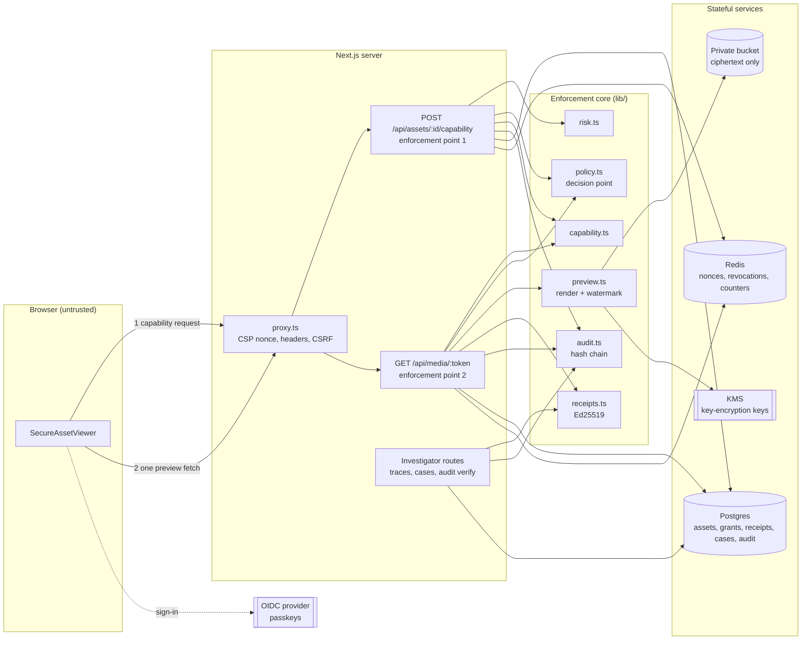
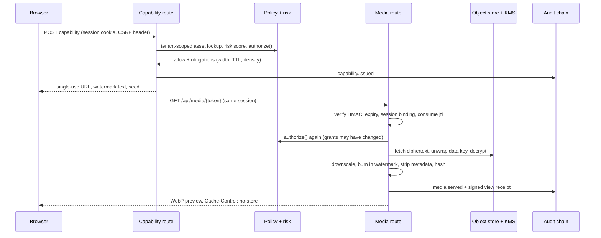

# Aegis Glass: architecture and security design

Status, 2026-11-21: the enforcement core, the Next.js app and the demo run and are tested end to end. Production adapters (Postgres, Redis, a cloud KMS, an OIDC provider) are designed but not built, and production mode refuses to start until they exist. Section 11 lists everything not built.

## 0. The limit this design starts from

Content shown on a screen the user controls cannot be protected from a screenshot, a screen recording or a phone camera. No web technology changes that. Aegis Glass therefore does not promise prevention. It aims for four things:

1. Nobody sees anything without a fresh, per-view authorization decision.
2. Every view that does happen is attributable to an account and a moment.
3. Copying is slower and less useful: low-resolution, short-lived, watermarked previews instead of originals.
4. Access can be withdrawn within seconds, and every decision leaves tamper-evident evidence.

Context-menu, drag, selection and print rules in the viewer are friction only. They are never counted as a control in this document.

## 1. System architecture

In this release, Postgres, Redis, the bucket and the KMS are in-memory stand-ins behind the same interfaces (`lib/repository.ts`, `lib/store.ts`, `lib/envelope.ts`).

## 2. Data flow and trust boundaries

| Boundary | Crosses it | What is trusted on the inside |
|---|---|---|
| Browser to server | Session cookie, capability token, JSON bodies | Nothing from the browser except a valid signature |
| Server to object store | Object key, ciphertext | Ciphertext integrity only; GCM tags verify it |
| Server to KMS | Wrapped data keys | The KMS's key custody |
| App to audit store | Records | Append-only enforcement in the database, not the app |
| Investigator to evidence | Trace token lookups | Investigator role plus phishing-resistant sign-in; every lookup audited |

## 3. Threat model (STRIDE)

| Category | Threat | Main controls |
|---|---|---|
| Spoofing | Stolen session cookie replayed from another browser | HttpOnly, Secure, SameSite=Strict cookie; short sessions; step-up for sensitive classes; new-device risk signal; instant revocation |
| Spoofing | Credential stuffing or account takeover | Delegated to the OIDC provider: passkeys for RESTRICTED and above, MFA for CONFIDENTIAL |
| Spoofing | Forged capability token | HMAC-SHA256 with rotating keys, timing-safe compare, strict shape check |
| Tampering | Edited token payload (other asset, wider preview) | Signature covers the whole payload |
| Tampering | Edited or deleted audit records | SHA-256 chain plus MAC; database triggers refuse UPDATE, DELETE, TRUNCATE; signed checkpoints |
| Tampering | Ciphertext moved to another asset or tenant | AES-256-GCM with tenant and asset bound as AAD |
| Repudiation | "I never opened that" | Ed25519-signed view receipt per preview, linked to the trace token printed on it |
| Repudiation | Admin denies revoking access | Revocations are audit events with actor and reason |
| Information disclosure | Cross-tenant ID guessing (IDOR) | Every lookup takes a tenant ID; cross-tenant answers 404, same as missing; RLS in Postgres |
| Information disclosure | Leaked preview URL | Single use, 20 to 300 second TTL, bound to the issuing session |
| Information disclosure | Browser, proxy or CDN caching | `Cache-Control: no-store, private`; blob URL in the page; `Cross-Origin-Resource-Policy: same-origin` |
| Information disclosure | Screenshot, recording, phone photo | Not preventable. Visible per-view watermark, reduced resolution, receipts, perceptual hash matching |
| Information disclosure | Image metadata (EXIF, GPS) | Previews are re-encoded; sharp drops metadata |
| Information disclosure | Titles of assets a user cannot open | Listing shows only assets the user can open now or after step-up |
| Information disclosure | Personal data in watermarks or logs | Keyed pseudonyms; no email, IP or name in marks, receipts or audit records (tested) |
| Denial of service | Preview rendering abuse | Per-session rate limits on capabilities (30/min) and media (60/min) |
| Denial of service | Decompression bomb in an original | `limitInputPixels` in sharp |
| Elevation of privilege | Tenant admin reads CROWN-JEWEL work | Separation of duties: admins need an explicit grant like anyone else |
| Elevation of privilege | Edited roles in the session cookie | Cookie is MAC'd; role list validated against a closed set |
| Elevation of privilege | Cross-site request forgery | SameSite=Strict, a custom header that forces CORS preflight, and an Origin-to-Host match, checked in the proxy and again in each route |
| Elevation of privilege | Stored or reflected XSS stealing previews | Nonce-based CSP with `strict-dynamic`; React output encoding; watermark text XML-escaped |

## 4. Control matrix

| Threat | Prevent | Detect | Respond | Evidence | Residual risk |
|---|---|---|---|---|---|
| Insider photographs or records the screen | Resolution caps by class; short-lived previews | Trace token on the leaked copy; perceptual-hash match | Investigator resolves the trace; human review; revoke grants | Signed receipt, audit chain | High. Deterrence and attribution, not prevention |
| Leaked preview URL | Single use, session binding, short TTL | `media.denied` with `session_mismatch` or `replay` | Raise risk; review if repeated | Audit records with capability ID | Low |
| Stolen session | Strict cookies; step-up for sensitive classes | New device, impossible travel (IdP), denial bursts | GUARDED or HIGH tightening; CRITICAL pause; admin revocation | `risk.state_changed`, cases | Medium until OIDC device binding lands |
| Bulk scraping by a valid user | Rate limits; low-resolution previews | Distinct-asset and view-count signals | HIGH: 640px, densest mark, 20s TTL; CRITICAL: pause | Risk decisions with reasons | Medium |
| Insider probing for sensitive files | Grants and compartments | Decoy access opens a case | Human review; no automatic accusation | `honey.accessed`, case | Low to medium |
| Cross-tenant access | Tenant-scoped queries; RLS | `capability.denied not_found` | Review on bursts | Audit | Low |
| Audit tampering | Append-only triggers; MAC; checkpoints | `verifyChain` on demand and scheduled | Incident; restore from replicated store | Signed checkpoints | Low once records replicate to object-lock storage (not built) |
| Grant revoked mid-session | Media route re-authorizes every fetch | `media.denied` | Viewer clears the image within one rotation | Audit | Low |
| Supply-chain compromise | Exact version pins, lockfile, `npm audit` in CI | CI audit gate | Patch and redeploy | CI logs | Medium; inherent to npm |

## 5. Implementation map

| File | Responsibility |
|---|---|
| `lib/policy.ts` | Deny-by-default decision point: tenant, risk, role, classification, auth strength and freshness, grants, obligations |
| `lib/capability.ts` | Signed, single-use, session-bound media capabilities with key rotation |
| `lib/service.ts` | Both enforcement points, risk counters, decoys, cases, revocation, investigations |
| `lib/preview.ts` | Per-view rendering: downscale, burn in watermark, strip metadata, SHA-256 and dHash |
| `lib/watermark.ts`, `lib/watermark-layout.ts` | Pseudonymous payload; deterministic rotating layout shared by server and browser |
| `lib/receipts.ts` | Ed25519 view receipts |
| `lib/audit.ts` | Hash-chained, MAC'd, serialized audit log; signed checkpoints |
| `lib/envelope.ts` | AES-256-GCM envelope encryption with AAD binding |
| `lib/risk.ts` | Explainable scoring and the response table |
| `lib/session.ts` | Demo session cookie (OIDC stand-in) |
| `lib/headers.ts`, `proxy.ts` | CSP with nonce, HSTS and other headers, CSRF |
| `lib/config.ts` | Mode resolution; production refuses to start |
| `components/SecureAssetViewer.tsx` | Capability refresh loop, blob-URL rendering, moving overlay, revocation handling, accessible status messages |
| `db/schema.sql` | Production schema with RLS and append-only triggers |

## 6. Data model and event taxonomy

Tables (see `db/schema.sql`): `tenants`, `principals` (no email column), `assets` (wrapped data key, original hashes), `policy_grants` (exactly one of asset or compartment, mandatory purpose and expiry), `view_receipts`, `risk_decisions`, `incident_cases` (closing requires a named reviewer and notes; legal-hold flag), `audit_events`, `audit_checkpoints`.

| Event | Emitted when | Key fields |
|---|---|---|
| `capability.issued` | A capability is granted | capabilityId, traceToken, ttl, width, density, risk, grantId, policyVersion |
| `capability.denied` | Issuance refused | reason, risk, policyVersion |
| `media.served` | A preview is delivered | capabilityId, traceToken, receiptId, sha256, dhash, width, density |
| `media.denied` | Delivery refused | reason (invalid, expired, replay, session_mismatch, revoked, policy) |
| `rate.limited` | A rate limit trips | bucket, count |
| `risk.state_changed` | A session's risk state changes | from, to, score, reasons |
| `session.revoked` | A session is revoked | reason, self |
| `grant.revoked` | A grant is revoked | grant ID |
| `honey.accessed` | A decoy is requested | session |
| `case.opened` | A review case opens | kind, asset, session |
| `trace.resolved` | An investigator looks up a trace | found |
| `audit.verified` | Someone verifies the chain | ok, checked |

Retention (proposal, needs legal approval): audit events and receipts 7 years for RESTRICTED and above, 2 years otherwise; risk counters 10 minutes to 30 days; cases until closed plus 2 years, unless on legal hold.

## 7. Staged rollout

| Stage | Scope | Build | Exit criteria |
|---|---|---|---|
| 1. Foundation | Internal only, synthetic data | Postgres, Redis, KMS and OIDC adapters; replicate audit to object-lock storage | All automated suites green against real services; production mode starts; key rotation rehearsed |
| 2. Controlled pilot | One team, CONFIDENTIAL and below | Upload pipeline with validation; monitoring and alerting | 2 weeks with zero authorization bypasses in pen test; p95 preview under 400 ms; accessibility audit passed |
| 3. Adaptive defense | RESTRICTED, then CROWN-JEWEL | Tuned risk thresholds from pilot data; decoys per workspace | False-positive CRITICAL rate under 1 per 1,000 sessions; every case reviewed within 2 business days |
| 4. Forensic operations | All tenants | Leak-intake workflow, scheduled chain verification, checkpoint publication | Leak drill: trace resolved within 1 hour; chain verified daily with no gaps |

## 8. Test plan

Automated in this release:

| Suite | Command | Covers |
|---|---|---|
| Unit and service | `npm test` (42 tests) | Policy matrix, capability forgery and expiry, audit tamper detection, envelope AAD binding, watermark escaping and pseudonymity, risk scoring, session forgery, end-to-end issuance and delivery, replay, leaked URLs, revocation, decoys, CRITICAL pause, investigator gating, perceptual matching after recompression |
| HTTP smoke | `node scripts/smoke.ts` against `next start` (29 checks) | Headers and CSP nonce, CSRF, cookie flags, caching headers, replay, leaked URL, IDOR, step-up, separation of duties, trace resolution, revocation, audit verification |
| Schema | `npm run schema:check` | Append-only triggers, grant constraint, RLS read and write isolation |
| Types and build | `tsc --noEmit`, `next build` | Type safety, production bundle |

Still to run before production: an external penetration test (authorization bypass, URL leakage, cache behaviour behind the real CDN); load testing of preview rendering; a screen-reader pass (NVDA, VoiceOver) and a WCAG 2.2 AA audit; an incident-response tabletop using a planted leak.

## 9. Rollback and acceptance

Rollback: the viewer and routes are additive. Disable by removing the routes from the deployment or by setting every asset to a classification served by the previous system. Audit and receipt tables are never rolled back or truncated; schema migrations are forward-only, with new columns nullable.

Acceptance for this release (all met on 2026-11-21): 42/42 unit and service tests, 29/29 smoke checks, schema guarantees verified on PostgreSQL 16, clean typecheck and build, `npm audit` reporting 0 vulnerabilities, production mode refusing to start, and no CSP violations in Chromium.

## 10. Needs legal, privacy or executive approval before production

- Decoy assets and their alerting: notice to staff, and a rule that a case is never treated as proof.
- The risk signals and their disclosure to users, including the working-hours signal.
- Retention periods for receipts, audit records and cases; legal-hold procedure.
- Who may hold the investigator role, and the two-person rule for resolving traces in employment matters.
- Any cross-border storage of evidence.
- Any future invisible or forensic watermarking: not built, and needs a separate legal and vendor review.

## 11. Not built in this release

Postgres, Redis, KMS and OIDC adapters; an upload pipeline with file validation and malware scanning; export flows (policy supports them; no route exists); replication of the audit trail to object-lock storage and scheduled checkpoint publication; alerting integrations; tile-based viewing for very large images; an alternative-format pipeline for long documents.
