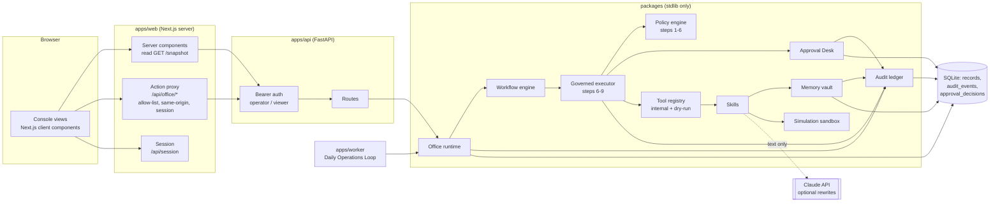
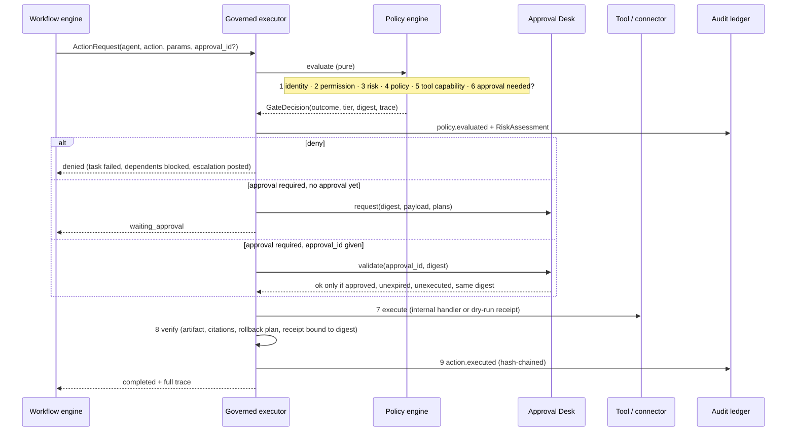

# System architecture

## Components



**Trust boundaries.** (1) Browser to console server: the browser never holds the API token; actions go through the
proxy, which checks an allow-list, the Origin header, and the session. (2) Console server to API: bearer token,
operator or viewer role. (3) API to core: every agent action enters `GovernedExecutor.perform`; there is no other
path to a tool. (4) Core to the outside world: only through a connector; in this build every external connector is
dry-run. (5) Core to the model: the provider returns text and has no tools.

## The nine-step action pipeline



Steps 1 to 6 are evaluated in full even after a failure, so the trace shown to the operator always has all of them.
The engine is pure: the `/policy/evaluate` dry run and the security review's control tests call it without side effects.

## Risk tiers

| Tier | Examples | Gate |
|---|---|---|
| low | drafts, research summaries, analysis, plans, simulations | auto-executes, logged |
| medium | branch commits, workflow creation, internal data updates, content calendar | executes internally, listed in the end-of-day report for review |
| high | publishing, outreach, email, staging deploy, purchases, data export | operator approval with a reason |
| critical | production deploy, credential access, deletion, security configuration, contracts, money movement, live price changes | operator approval + change, rollback, and verification plans + post-action verification |

Escalation modifiers apply to acting actions (level write or execute): `environment=production` lifts to critical,
external `recipients` lift to high, `record_count > 1000` lifts one tier. Instruction-like text in any input forces
human review without changing the tier. Unknown action types are denied as critical.

## State and storage

- **MVP runtime:** SQLite (`packages/agent_core/store.py`). Records are JSON documents keyed by (kind, id), with no
  delete method. `audit_events` and `approval_decisions` are separate tables with triggers that abort UPDATE and DELETE.
  WAL mode lets the API and the worker share the file.
- **Production target:** PostgreSQL 16, `infra/db/postgres/001_init.sql`, normalized, with foreign keys, closed-set
  CHECK constraints, and append-only triggers on five tables. A parity test keeps it in step with the models.
- **Secrets:** referenced by name (`vault:social/linkedin`), resolved only at the connector boundary, never placed in
  agent context, memory, outputs, or the ledger. The ledger also redacts credential-shaped strings before hashing.

## Runtime topology

| Process | Command | Notes |
|---|---|---|
| API | `python office.py serve` | Single process; the Office holds one SQLite connection behind a lock |
| Worker | `python office.py daily-loop` | Cron or the compose `worker` service; same database |
| Console | `npm run start` in `apps/web` | Stateless; reads `/snapshot`, forwards actions |

Scaling path (roadmap): PostgreSQL adapter, then a queue (Redis or a managed queue) so wave tasks run concurrently in
workers, then OIDC sign-in replacing bearer tokens. The policy engine and executor do not change.

## Repository layout

```
clearglass-agent-office/
├── office.py                          CLI entry point
├── pyproject.toml                     pytest + ruff config (pythonpath: packages, .)
├── requirements.txt / -dev.txt        runtime / test pins
├── config/
│   ├── company.json                   objectives, ICP, approved sources, brand guidelines
│   ├── org.json                       12 rooms, 7 departments, 35 agents, base grants
│   ├── policy.json                    tiers, 42-action catalog, hard blocks, department rules, modifiers
│   └── tools.json                     19 tools, connectors, risk ceilings, secret references
├── demo/
│   ├── missions.json                  the four demo missions
│   └── prospects.sample.json          fictional prospects, one with an injected instruction
├── packages/
│   ├── agent_core/
│   │   ├── models.py                  16 record types
│   │   ├── config.py                  config loading + org validation (fails closed)
│   │   ├── office.py                  runtime hub, operator actions, emergency stop
│   │   ├── governance.py              GovernedExecutor: steps 6-9
│   │   ├── approvals.py               Approval Desk
│   │   ├── workflow.py                DAG engine
│   │   ├── skills.py                  internal tool handlers
│   │   ├── security_audit.py          config review + 18 negative control tests
│   │   ├── reports.py                 briefing, end-of-day, weekly, KPIs
│   │   ├── providers.py               offline + Claude text providers
│   │   ├── store.py                   SQLite persistence
│   │   └── util.py                    clocks, id factories
│   ├── policy_engine/                 policy.py, engine.py (steps 1-6), verify.py (step 8)
│   ├── audit_ledger/                  ledger.py, canonical.py (canonical JSON, digests, redaction)
│   ├── memory_vault/                  vault.py
│   ├── tool_registry/                 registry.py (dry-run connector), vault.py (secret refs)
│   ├── simulation/                    sandbox.py (pricing, campaign, incident, rollout)
│   └── ui/                            tokens.json
├── apps/
│   ├── api/                           main.py, security.py, snapshot.py
│   ├── worker/                        daily_loop.py
│   └── web/                           Next.js 16 console (src/app: 9 views + 2 route handlers)
├── infra/
│   ├── db/postgres/001_init.sql
│   ├── docker/{api,web}.Dockerfile
│   └── docker-compose.yml
├── docs/                              this folder
└── tests/                             13 test modules
```
