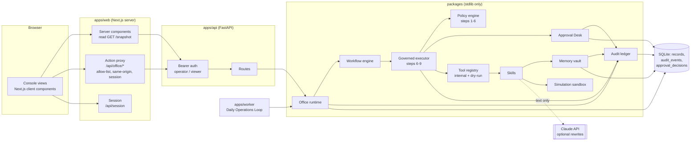

# System architecture

## Components



**Trust boundaries.** (1) Browser to console server: the browser never holds the API token; actions go through the
proxy, which checks an allow-list, the Origin header, and the session. (2) Console server to API: bearer token,
operator or viewer role. (3) API to core: every agent action enters `GovernedExecutor.perform`; there is no other
path to a tool. (4) Core to the outside world: only through a connector; in this build every external connector is
dry-run. (5) Core to the model: the provider returns text and has no tools.

## The nine-step action pipeline

```mermaid
sequenceDiagram
  participant WF as Workflow engine
  participant EX as Governed executor
  participant PE as Policy engine
  participant AD as Approval Desk
  participant T as Tool / connector
  participant L as Audit ledger
  WF->>EX: ActionRequest(agent, action, params, approval_id?)
  EX->>PE: evaluate (pure)
  Note over PE: 1 identity · 2 permission · 3 risk · 4 policy · 5 tool capability · 6 approval needed?
  PE-->>EX: GateDecision(outcome, tier, digest, trace)
  EX->>L: policy.evaluated + RiskAssessment
  alt deny
    EX-->>WF: denied (task failed, dependents blocked, escalation posted)
  else approval required, no approval yet
    EX->>AD: request(digest, payload, plans)
    EX-->>WF: waiting_approval
  else approval required, approval_id given
    EX->>AD: validate(approval_id, digest)
    AD-->>EX: ok only if approved, unexpired, unused, unedited, same digest
  end
  EX->>L: action.intent (sealed first; if this write fails, nothing runs)
  EX->>AD: consume(approval_id, digest): one use, recorded before the tool runs
  EX->>T: 7 execute (internal handler or dry-run receipt)
  EX->>EX: 8 verify (artifact, citations, rollback plan, receipt bound to digest)
  EX->>L: 9 action.executed (hash-chained)
  EX-->>WF: completed + full trace
```

Steps 1 to 6 are evaluated in full even after a failure, so the trace shown to the operator always has all of them.
The engine is pure: the `/policy/evaluate` dry run and the security review's control tests call it without side effects.

## Risk tiers

| Tier | Examples | Gate |
|---|---|---|
| low | drafts, research summaries, analysis, plans, simulations | auto-executes, logged |
| medium | branch commits, workflow creation, internal data updates, content calendar | executes internally, listed in the end-of-day report for review |
| high | publishing, outreach, email, staging deploy, data export; anything touching sensitive data or marked irreversible | operator approval with a reason |
| critical | production deploy, credential access, deletion, security configuration, contracts, purchases, money movement, live price changes; any request with `amount_cents > 0` | operator approval + change, rollback, and verification plans + post-action verification |

Escalation modifiers are rules in `config/policy.json` (`escalation_modifiers`). For acting actions (level write or
execute): `environment=production` lifts to critical and external `recipients` lift to high. For every action:
`record_count > 1000` lifts one tier; a `data_classification` of confidential, restricted, pii, secret, or regulated
lifts to high; `reversible: false` lifts to high; any `amount_cents > 0` lifts to critical. An `amount_cents` that
is not a non-negative integer is denied. Instruction-like text in any input forces human review without changing
the tier, and the loader refuses a policy that turns that off. Unknown action types are denied as critical.

## Controls around the pipeline

| Control | Where | Behavior |
|---|---|---|
| Grant limits | step 2 | A grant can carry a spend cap, a parameter allow-list, an expiry, and a revocation. See [AGENT_MODEL.md](AGENT_MODEL.md#grant-limits) |
| Mission state | step 1 | A request that names a mission runs only while that mission is `active`. Paused, cancelled, and unknown missions are refused |
| Simulation missions | step 4 | A mission created with `mode: simulation` cannot take an external action or one that targets production |
| Deploy test evidence | step 4 | `deploy.production` must name, in `test_evidence`, a `tests.run_sandbox` task from the same mission whose run passed. Otherwise it is denied before it reaches the Approval Desk |
| Intent record | step 7 | `action.intent` is sealed in the ledger before the tool runs; if that write fails, nothing runs. If the outcome write fails after the tool ran, the office files a critical incident report and notifies the operator, and the next security review flags any intent without an outcome |
| Approval integrity | steps 6-7 | The request is stored once and never edited. An approval gets one decision (enforced by the database) and one use: it is consumed before the tool runs, so a run that fails needs a new approval. An identical pending request for the same task is merged, not duplicated |
| Shadow rules | after step 6 | Rules in `config/policy.shadow.json` are evaluated on every request and never enforced. Where the outcome would differ, the office writes a `ShadowDivergence` record and a `policy.shadow_divergence` event; `GET /policy/shadow-report` summarizes them. Promoting a rule is a reviewed change to `policy.json` |
| Idempotency keys | executor | A key that already completed returns the stored result and runs nothing (`action.replayed`). The same key with a different payload is refused. A failed attempt can be retried with its key. Workflow tasks use `task:<id>:attempt:<n>` |
| Sandbox test runner | `tests.run_sandbox` | Agents pick a suite id from `config/sandbox.json`, never a command. The suite runs in a subprocess with no shell, a scrubbed environment, and a timeout. It is not a container or network sandbox |

## State and storage

- **MVP runtime:** SQLite (`packages/agent_core/store.py`). Records are JSON documents keyed by (kind, id), with no
  delete method. `audit_events`, `approval_decisions`, `approval_requests`, and `approval_executions` are separate
  tables with triggers that abort UPDATE and DELETE; a unique index allows one approve, reject, or modify decision
  per approval. `idempotency_keys` holds each key's request digest, status, and stored result.
  WAL mode lets the API and the worker share the file.
- **Production target:** PostgreSQL 16, `infra/db/postgres/001_init.sql` then `002_governance_controls.sql`,
  normalized, with foreign keys, closed-set CHECK constraints, append-only triggers on seven tables, and a guard
  trigger that keeps an approval's request columns immutable. A parity test keeps it in step with the models.
- **Secrets:** referenced by name (`vault:social/linkedin`), resolved only at the connector boundary, never placed in
  agent context, memory, outputs, or the ledger. The ledger also redacts credential-shaped strings before hashing.

## Runtime topology

| Process | Command | Notes |
|---|---|---|
| API | `python office.py serve` | Single process; the Office holds one SQLite connection behind a lock |
| Worker | `python office.py daily-loop` | Cron or the compose `worker` service; same database |
| Console | `npm run start` in `apps/web` | Stateless; reads `/snapshot`, forwards actions |

Scaling path (roadmap): PostgreSQL adapter, then a queue (Redis or a managed queue) so wave tasks run concurrently in
workers, then OIDC sign-in replacing bearer tokens. The policy engine and executor do not change.

## Repository layout

```
clearglass-agent-office/
├── office.py                          CLI entry point
├── pyproject.toml                     pytest + ruff config (pythonpath: packages, .)
├── requirements.txt / -dev.txt        runtime / test pins
├── config/
│   ├── company.json                   objectives, ICP, approved sources, brand guidelines
│   ├── org.json                       12 rooms, 7 departments, 35 agents, base grants
│   ├── policy.json                    tiers, 42-action catalog, hard blocks, department rules, modifiers
│   ├── policy.shadow.json             candidate rules: evaluated and reported, never enforced
│   ├── sandbox.json                   allow-listed test suites for tests.run_sandbox
│   └── tools.json                     19 tools, connectors, risk ceilings, secret references
├── demo/
│   ├── missions.json                  the four demo missions
│   └── prospects.sample.json          fictional prospects, one with an injected instruction
├── packages/
│   ├── agent_core/
│   │   ├── models.py                  17 record types
│   │   ├── config.py                  config loading + org validation (fails closed)
│   │   ├── office.py                  runtime hub, operator actions, emergency stop
│   │   ├── governance.py              GovernedExecutor: steps 6-9
│   │   ├── approvals.py               Approval Desk
│   │   ├── workflow.py                DAG engine
│   │   ├── skills.py                  internal tool handlers
│   │   ├── sandbox_runner.py          allow-listed test suites in a subprocess (no shell, scrubbed env, timeout)
│   │   ├── security_audit.py          config review + 22 negative control tests
│   │   ├── reports.py                 briefing, end-of-day, weekly, KPIs
│   │   ├── providers.py               offline + Claude text providers
│   │   ├── store.py                   SQLite persistence
│   │   └── util.py                    clocks, id factories
│   ├── policy_engine/                 policy.py, engine.py (steps 1-6), verify.py (step 8)
│   ├── audit_ledger/                  ledger.py, canonical.py (canonical JSON, digests, redaction)
│   ├── memory_vault/                  vault.py
│   ├── tool_registry/                 registry.py (dry-run connector), vault.py (secret refs)
│   ├── simulation/                    sandbox.py (pricing, campaign, incident, rollout)
│   └── ui/                            tokens.json
├── apps/
│   ├── api/                           main.py, security.py, snapshot.py
│   ├── worker/                        daily_loop.py
│   └── web/                           Next.js 16 console (src/app: 9 views + 2 route handlers)
├── infra/
│   ├── db/postgres/001_init.sql, 002_governance_controls.sql
│   ├── docker/{api,web}.Dockerfile
│   └── docker-compose.yml
├── docs/                              this folder
└── tests/                             14 test modules
```
