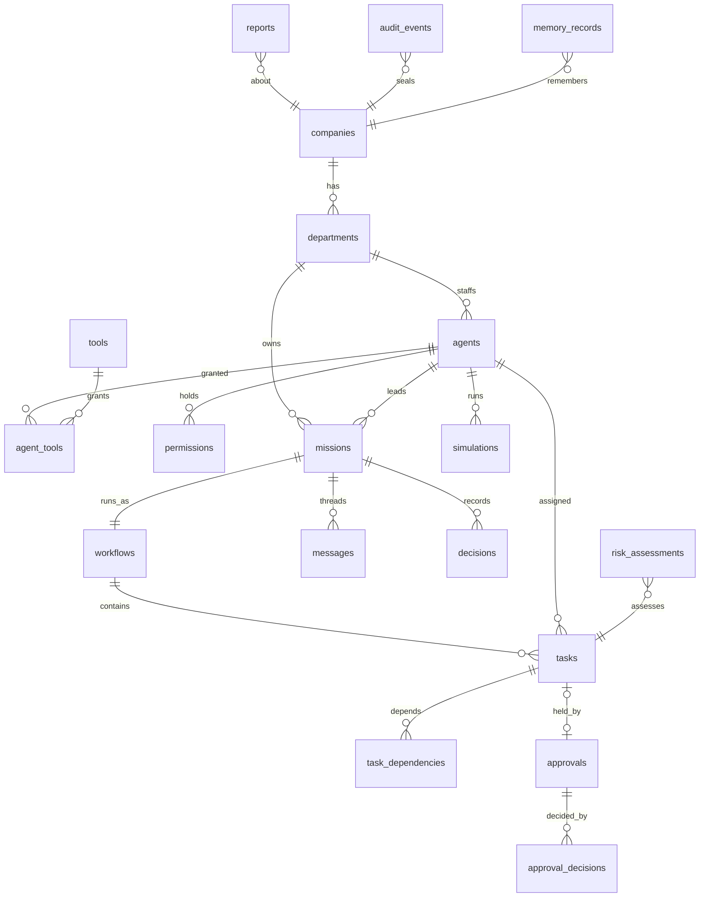

# Database schema

The production schema is [`infra/db/postgres/001_init.sql`](../infra/db/postgres/001_init.sql) followed by
[`002_governance_controls.sql`](../infra/db/postgres/002_governance_controls.sql) (PostgreSQL 16).
`tests/test_schema_parity.py` fails if a model field has no column or a migration is misnumbered;
`tests/test_postgres_schema.py` applies every migration to a real server and checks the constraints below.

## Entities

| Model (`agent_core.models`) | Table | Notes |
|---|---|---|
| Company | `companies` | objectives, ICP, approved sources, brand guidelines as JSONB |
| Department | `departments` | `head` FK to agents (deferrable, circular) |
| Agent | `agents` + `agent_tools` + `permissions` | `reports_to` checked by a deferred constraint trigger (agent id or `operator`) |
| Permission | `permissions` | `level` CHECK excludes `approve` (human-only). `constraints` accepts only `spend_limit_cents` (>= 0) and `payload_allowlist`; `revoked_at` and `revoked_by` must be set together |
| Tool | `tools` | connector in (internal, dry_run, live); `secret_ref` pattern-checked |
| Mission | `missions` | unique non-empty `key`; FK to its workflow (deferrable); `mode` in (production, simulation) |
| Workflow | `workflows` | `task_ids` and `waves` derive from `tasks.workflow_id` and `tasks.wave` |
| Task | `tasks` + `task_dependencies` | unique (workflow_id, key); no self-dependency |
| Approval | `approvals` | critical rows must carry all three plans; approved/executed rows must carry `approved_digest`. A guard trigger keeps the request columns and a set `approved_digest` immutable, freezes executed, rejected, cancelled, and expired rows, and rejects DELETE |
| Approval decisions | `approval_decisions` | **append-only**; reason >= 12 characters; a partial unique index allows one approve, reject, or modify per approval |
| Approval use | `approval_executions` | **append-only**; primary key is the approval id, so an approval is used once |
| Idempotency key | `idempotency_keys` | key, request digest, status (in_progress, completed, failed); a completed row must carry its result |
| Message | `messages` | **append-only**; closed set of kinds |
| Decision | `decisions` | **append-only** |
| MemoryRecord | `memory_records` | layer/status combinations enforced; approved rows need `approved_by` |
| AuditEvent | `audit_events` | **append-only**; hashes are 64 hex characters; `prev_hash` chain verified by the app |
| Simulation | `simulations` | runs 100-20000; disclaimer required |
| Report | `reports` | briefing, eod, weekly, incident, after_action, security_review |
| RiskAssessment | `risk_assessments` | **append-only**; score 0-100; outcome allow/approval_required/deny |
| ShadowDivergence | `shadow_divergences` | **append-only**; enforced and shadow outcomes must differ; at least one rule id |

Append-only tables reject UPDATE, DELETE, and TRUNCATE with `insufficient_privilege`. Every foreign key has an index.

## Migration notes

- Each migration runs in one transaction. Apply them in number order with `psql -v ON_ERROR_STOP=1 -f <file>`.
  `001_init.sql` is never edited after release; changes go in a new numbered file.
- `002_governance_controls.sql` adds grant limits, mission mode, the approval guard and one-decision index,
  `approval_executions`, `idempotency_keys`, and `shadow_divergences`.
- The SQLite store keeps the immutable request in its own `approval_requests` table; PostgreSQL enforces the same
  rule with the guard trigger on `approvals`.
- Grant the application role INSERT and SELECT only on the append-only tables. The triggers are the second line.
- The MVP's SQLite store keeps the same record shapes as JSON; moving to PostgreSQL is a store adapter plus a one-time
  copy, with `verify()` run on the ledger before and after (roadmap week 2).
