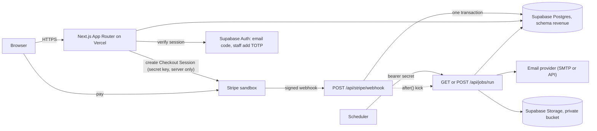
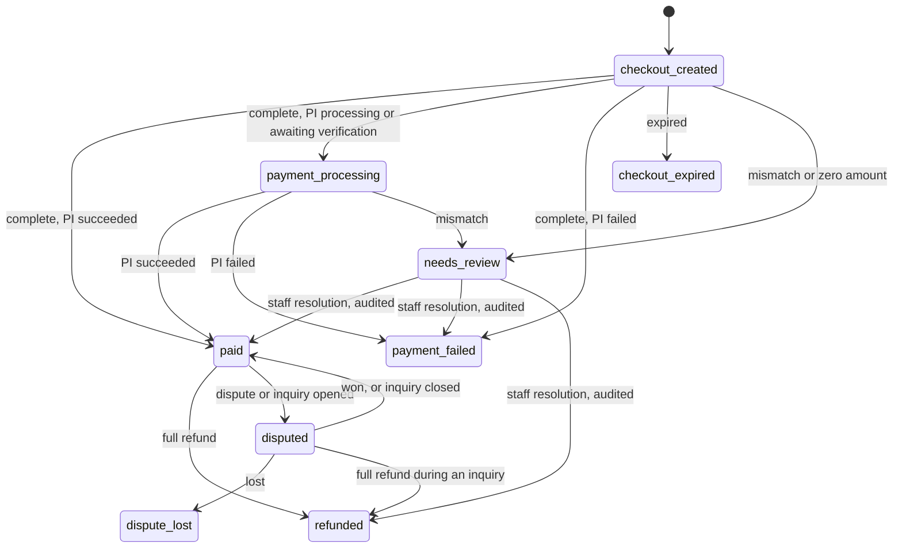

# Revenue Engine MVP: design for owner approval

**Status: PROPOSED. Not approved. Nothing here is built.** No application code, migrations, workflows, Stripe objects, Supabase projects, or Vercel projects exist for this design. Written 2026-11-15. Revised 2026-11-21 after the evidence was checked again; [section 0](#0-revision-2026-11-21) lists what changed.

Flow in scope, Stripe **test mode only**:

Landing page → Stripe Checkout → verified payment → private intake → audit draft → human approval → delivery → revenue reporting.

Rules for anyone working in this directory:

1. Don't add application code, migrations, workflows, or cloud resources until the owner approves this document. Record that approval in [section 17](#17-approval-record) only when the owner states it.
2. Test mode only. Going live needs its own approval (D18).
3. This repository is public. No secrets, customer data, or personal information go in it.

## Contents

0. [Revision 2026-11-21](#0-revision-2026-11-21)
1. [Evidence base](#1-evidence-base)
2. [ADR-001: application boundary](#2-adr-001-application-boundary)
3. [Checks that would change the decision](#3-checks-that-would-change-the-decision)
4. [MVP scope](#4-mvp-scope)
5. [User flow](#5-user-flow)
6. [Architecture](#6-architecture)
7. [Data model](#7-data-model)
8. [Stripe integration](#8-stripe-integration)
9. [Webhook and fulfillment state machine](#9-webhook-and-fulfillment-state-machine)
10. [Approval gate](#10-approval-gate)
11. [Delivery and access control](#11-delivery-and-access-control)
12. [Revenue reporting](#12-revenue-reporting)
13. [Security and operations](#13-security-and-operations)
14. [Implementation sequence](#14-implementation-sequence)
15. [Test plan](#15-test-plan)
16. [Deployment and rollback](#16-deployment-and-rollback)
17. [Approval record](#17-approval-record)
18. [Unresolved decisions](#18-unresolved-decisions)
19. [Sources](#19-sources)

## 0. Revision 2026-11-21

The owner sent the brief again. Before answering, the evidence in section 1 was checked again. The architecture and the boundary decision stand. What changed:

**New or corrected evidence** (section 1)

- E10 corrected: seven live Payment Links send paying buyers to `/offers/thank-you.html`, not one. This repository has no such page (D15).
- E11: Stripe's business profile describes a trading-automation script, not the services ClearGlass sells (D20).
- E12: the Agent Office's Revenue Floor (2026-11-20) is a second revenue system with its own money ledger. Without a boundary, one sale could be counted twice (D19).
- E13: the live Stripe account has one webhook endpoint, created 2026-11-11, that sends subscription events to a third-party service (D21).
- E14: the CLE-19 repository (`ClearGlasslabs/ClearGlassInc.`) refused attachment, and a third GitHub owner appears in Stripe product metadata. The preview's source could be under any of the three (O6).
- E15: the Linear project proposes a fourth audit-type offer at CAD 750 to 1,500 (D1).

**Design corrections**

1. A paid session whose order row is missing (after a database restore, for example) was recorded as `ignored_foreign`, which loses the sale without a trace. It is now an `orphan`: recorded, alerted, and listed by reconciliation (section 9).
2. Delivery also requires the order to still be `paid`, so a refund or dispute after approval stops delivery (sections 9, 11).
3. Disputes get their own order states (`disputed`, `dispute_lost`) and the `charge.dispute.closed` event. Before, no event could write the `dispute_loss` revenue rows (sections 7, 9).
4. Staff confirm that the buyer controls the in-scope domains before any audit work starts: job state `authorization_verified` and the append-only `authorization_checks` table (sections 5, 7, 9).
5. The job runner accepts GET as well as POST, because Vercel Cron calls routes with GET (sections 6, 9).
6. The session retrieve expands `line_items` as well as `payment_intent`, so the Price check reads Stripe's record (section 9).
7. The stuck-payment alert separates micro-deposit verification (up to 10 days) from PAD confirmation (up to 5 business days) (section 8).
8. Customer emails carry CASL sender identification and an unsubscribe line, as the Revenue Floor's do [LEGAL REVIEW] (sections 4, 13).
9. If the package lives in this repository, its Vercel project uses an Ignored Build Step, so commits elsewhere in the repository don't redeploy it (section 2).
10. The minimum permissions of the restricted Stripe key are listed (section 13).

Stripe facts were re-read on 2026-11-21. The Supabase, Vercel-plan, and CRA facts come from the 2026-11-15 sources. `vercel.com` could not be reached from the session, so the Vercel Cron behaviour in item 5 comes from Vercel's documentation as excerpted in search results (section 19).

## 1. Evidence base

Checked on 2026-11-15. Rows marked "11-21" were checked again or added on 2026-11-21. VERIFIED means inspected directly. UNVERIFIED means it could not be inspected from the session that wrote this.

| # | Claim | Status | Evidence |
|---|---|---|---|
| E1 | Source of the Vercel project `clearglass-app-preview` is available | UNVERIFIED (not available), 11-21 | Not among the repositories the session can attach (five on 11-21, none of them this app). GitHub repository search for `clearglass-app-preview` and `clearglass-quick-audit` returned 0 results on both dates. No Vercel connector. `*.vercel.app`, `vercel.com`, and `www.clearglassinc.com` are unreachable from the sandbox |
| E2 | Vercel projects `clearglass-quick-audit` and `clearglass-app-preview` exist | UNVERIFIED, 11-21 | Same as E1 |
| E3 | A Supabase project exists | UNVERIFIED, 11-21 | No connector. Neither repository configures Supabase; the word appears only in a logo list and a search pattern |
| E4 | Repositories with push access | VERIFIED, 11-21 | `ClearGla88/ClearGlass-Inc.` (public). `ClearGla88/CG` (private: test suites and two static pages, no package manifest). Three forks: `osiris`, `templates` (Cloudflare Workers templates), `ground-station`. None is a Next.js payments app |
| E5 | Next.js code in this repository | VERIFIED, 11-21 | `aegis-glass-platform/` (Next.js 15.5.29, `pg`, zod, vitest; a confidential-image viewer whose production sign-in is blocked until an OIDC adapter exists) and `clearglass-agent-office/apps/web` (Next.js 16.4.5, the agent office's operator console). Neither is a payments app |
| E6 | Stripe account currency | VERIFIED (read-only), 11-21 | Account country CA, default currency CAD, all 10 active prices in CAD. The connected Stripe tool exposes only the live account, so no sandbox objects could be inspected |
| E7 | A 497 price exists | VERIFIED: no, 11-21 | Audit-type prices: Security Quick-Audit CAD 249 and 90-Minute Cyber Risk Audit CAD 297 |
| E8 | A webhook delivers Stripe events to a ClearGlass application | VERIFIED: no, 11-21 | No webhook endpoint targets a ClearGlass-run service. The one endpoint that exists belongs to a third party (E13) |
| E9 | Existing subscription specification | VERIFIED, 11-21 | Linear CLE-19, In Progress, last updated 2026-10-16. It targets an Express API on Render in `ClearGlasslabs/ClearGlassInc.`, which this session cannot attach (E14). Its deploy was blocked on 2026-10-16 |
| E10 | Post-payment page of the live Payment Links | VERIFIED (configuration), 11-21 / UNVERIFIED (live) | Seven of the ten active live Payment Links redirect paying buyers to `https://www.clearglassinc.com/offers/thank-you.html`: the Quick-Audit, the 90-Minute Cyber Risk Audit, the PHIPA and Hardening deposits, Managed Monitoring, and Business Protection monthly and annual. This repository has `CNAME` `www.clearglassinc.com` and deploys to GitHub Pages from `main`, but no `offers/` directory has ever existed in its history, and 56 of its HTML files link into `offers/`. Whether the live site serves those pages from another source could not be checked from the sandbox |
| E11 | Stripe's business profile matches what is sold | VERIFIED: no, 11-21 | The account's product description is for a trading-automation script sold to traders. The merchant category code is 5734 (computer software stores). Stripe collects these details for its account review (section 19) |
| E12 | Another revenue system in this repository | VERIFIED, 11-21 | The Agent Office's Revenue Floor (2026-11-20) runs one governed sales path for the CAD 249 Quick-Audit through PayPal invoices that a person sends, with its own append-only money ledger. Its status report lists verifying website (Stripe) payments as blocked, with no import path |
| E13 | Third parties receiving live Stripe events | VERIFIED, 11-21 | One live webhook endpoint, created 2026-11-11 and described as "Grok automations", sends `customer.subscription.created` and `customer.subscription.deleted` to a grok.com URL |
| E14 | GitHub owners connected to ClearGlass code | VERIFIED, 11-21 | `ClearGla88`: this session's access. `ClearGlasslabs`: holds CLE-19's repository; attaching it was refused. `ClearGlassInc`: named as a source repository in one live Stripe product's metadata; not attachable |
| E15 | Other offers next to the 497 audit | VERIFIED, 11-21 | The Linear project "ClearGlass AI Corporation Revenue Engine" proposes an "AI Operations & Exposure Assessment" at CAD 750 to 1,500, marked indicative and awaiting executive approval |

## 2. ADR-001: application boundary

**Context.** The brief prefers extending `clearglass-app-preview`, but only if its source can be inspected and is fit to host a revenue-critical flow. It cannot be inspected (E1, E2). On 2026-11-21 it still could not, and ClearGlass code is now known to sit under three GitHub owners, two of which this session cannot reach (E14).

**Decision (proposed).** Build a separate application: a self-contained Next.js package at `revenue-engine/` in this repository. It deploys as its own Vercel project (Root Directory `revenue-engine`) and uses its own Supabase project and its own Stripe sandbox.

**Rationale.**

1. Extending an application nobody can audit fails the brief's own condition.
2. A payments path benefits from isolation: separate secrets, deploys, rollbacks, and CI gate, with the blast radius limited to one offer.
3. This repository already holds the patterns the MVP needs. `aegis-glass-platform/` has a self-contained Next.js package, SQL migrations, append-only triggers, and PGlite plus PostgreSQL 16 tests. `clearglass-agent-office/` has payload-bound approvals and an append-only audit trail. Baseline CI has the zizmor workflow gate and the secret-hygiene check.

**Hosts rejected inside this repository.**

- `aegis-glass-platform/`: a different product, and production sign-in is blocked.
- `clearglass-agent-office/`: a FastAPI agent-governance kernel with operator-token auth. Coupling customer payments to it widens its blast radius, and the brief asks for Next.js with Supabase.

**Consequences.** A new Vercel project, environment, subdomain, Supabase Auth configuration, and monitoring. The design does not depend on its host: it uses App Router route handlers, a server-only library, and SQL migrations. If `clearglass-app-preview` later passes the checks in section 3, the package can move into it as its own route group. In this repository, the Vercel project sets Root Directory `revenue-engine` and the Ignored Build Step `git diff HEAD^ HEAD --quiet -- .`, so commits outside the package don't rebuild it.

**Open trade-off (D4).** This repository is public, so the application's source would be public. Secrets and data never live in a repository. If the owner wants the source private, create a private repository; nothing else in this design changes.

## 3. Checks that would change the decision

These need the owner, because no tool in the design session can reach Vercel or the preview's source:

- O1. Vercel, project `clearglass-app-preview`, Settings, Git: which repository and branch deploy it. Attach that repository to a session.
- O2. The Vercel plan. Hobby is for non-commercial personal use only, and Vercel counts taking payments as commercial use.
- O3. Environment variable **names** for each project (never values).
- O4. Domains attached to each project.
- O5. Whether a Supabase project exists, with its plan and region.
- O6. Which GitHub owner holds the preview's source: `ClearGla88`, `ClearGlasslabs`, `ClearGlassInc`, or another (E14). If that account is suspended, its repositories can't be reached and C10 fails.

With the source attached, run these and record each result:

| Check | Command or place | Passes when |
|---|---|---|
| C1 Framework | `jq '.dependencies.next' package.json` | A supported Next.js major |
| C2 Router | `ls -d app src/app pages 2>/dev/null` | App Router |
| C3 Auth | `grep -rlE "@supabase/ssr\|next-auth\|@clerk\|iron-session" --include='*.ts*' .` | Server-side session verification exists, or there is no auth to untangle |
| C4 Client secrets | `grep -rnE "NEXT_PUBLIC_[A-Z_]*(SECRET\|PRIVATE)" .` and a scan of the built `.next/static` | No secret reaches the browser |
| C5 Database access | `grep -rlE "@supabase/supabase-js\|from 'pg'\|@prisma/client\|drizzle-orm" .` | Database access happens only on the server |
| C6 Health | `npm ci && npx tsc --noEmit && npm test && npm run build` | All pass at HEAD |
| C7 Coupling | `find app -name 'page.tsx' -o -name 'route.ts'` | Revenue routes fit under their own segment without editing unrelated code |
| C8 Dependencies | `npm audit --audit-level=high` | No high or critical advisories |
| C9 Deploy path | `vercel.json`, Vercel project settings | Build and deploy path known, preview protection known |
| C10 Ownership | GitHub | The owning account is active and grants push access |

All ten pass: move the package into the preview app as a route group. Any failure: keep the separate application.

## 4. MVP scope

**In scope**

- One offer and one Stripe Price: 497.00 in a configured currency (D1, D2).
- Hosted Stripe Checkout in payment mode, test mode only.
- Fulfillment driven by webhooks, a success-page fallback, and a scheduled reconciliation.
- Customer sign-in by email one-time code, then a private intake with an authorization attestation.
- Staff confirm that the buyer controls every in-scope domain before work starts.
- Staff upload a versioned PDF draft. An approver approves or rejects it. Delivery goes through an expiring link.
- Staff-only revenue and fulfillment reports, and a reconciliation report.

**Out of scope for the MVP**

Subscriptions (CLE-19), tiers, coupons, invoices or quotes, AI-generated drafts, CRM or outreach automation, public dashboards, Interac e-Transfer, live mode.

**Content rules**

- No invented customers, testimonials, metrics, scarcity, or guarantees.
- The landing page states what the audit includes, what it excludes, the turnaround, the price, and the currency.
- The authorization and scope terms need counsel review (D12).
- Customer emails are transactional. They carry the sender identification and unsubscribe line that CASL s.6(2) requires; s.6(6) exempts these messages from the consent requirement only [LEGAL REVIEW].

## 5. User flow

| Step | Actor | Surface | System writes | Gate |
|---|---|---|---|---|
| 1 | Visitor | `/` landing page (offer, price, and currency from server config) | Nothing. Analytics, if any, never counts as revenue | None |
| 2 | Visitor | `POST /api/checkout` | `orders` (`checkout_created`), `checkout_sessions` | Kill switch, rate limit, Stripe Price verified against config |
| 3 | Customer | Stripe-hosted Checkout | Nothing (Stripe holds the money) | Stripe |
| 4 | Stripe | `POST /api/stripe/webhook` | Payment, state, audit job, and outbox rows in **one transaction** | Signature, test mode, amount, currency and Price match, payment status |
| 5 | Customer | `/checkout/success?session_id=…` | May run the same idempotent apply function | Shows status only. Grants nothing |
| 6 | System | Plain-text intake invitation email | Outbox status | Job runner authenticated |
| 7 | Customer | `/sign-in` (email one-time code), then `/orders/{id}/intake` | Contact bound to the auth user; intake and attestation | Verified email equals the order email, order `paid`, job `awaiting_intake` |
| 8 | Staff | `/admin/orders/{id}` | `authorization_checks` row (method and evidence reference); job `authorization_verified` | Staff and AAL2. Method: a DNS TXT token on each in-scope domain, a reply from a mailbox on that domain, or a signed authorization letter |
| 9 | Staff | `/admin/orders/{id}` | Draft version (PDF, SHA-256); job `in_review` | Staff allowlist and MFA (AAL2); job `authorization_verified` or `changes_requested` |
| 10 | Approver | `/admin/orders/{id}` | Append-only approval bound to the draft hash; job `approved` or `changes_requested`; delivery job queued | Approver role, AAL2, draft is current, hash matches |
| 11 | System | Delivery job; plain-text "report ready" email | `deliveries`; job `delivered` | Approval re-checked, file re-hashed, order still `paid` |
| 12 | Customer | `/orders/{id}/report` | Access log entry | Owns the order, job `delivered`, signed URL valid 5 minutes |
| 13 | Staff | `/admin/revenue` | Nothing | Staff and AAL2, explicit test or live filter |

A one-time code is used instead of a magic link because corporate mail scanners can open a link before the customer does and spend it.

## 6. Architecture

| Component | Responsibility | Notes |
|---|---|---|
| Next.js app (TypeScript, App Router) | Landing, checkout, success and cancel, intake, admin, report pages | Private data is read only on the server |
| `src/lib/server/*` | Stripe client, database pool, state machine, authorization | Each module imports `server-only` |
| `POST /api/checkout` | Create the order and the Checkout Session | Never reads an amount, price, or currency from the request |
| `POST /api/stripe/webhook` | Verify, record, transition, enqueue | Node.js runtime, raw body |
| `GET` and `POST /api/jobs/run` | Claim and run outbox jobs, run reconciliation | Bearer `CRON_SECRET` on both methods. Vercel Cron calls with GET and sends the header itself; Supabase Cron and the `after()` kick after each webhook use POST |
| Supabase Postgres | System of record for orders, jobs, approvals, and the revenue ledger | Stripe stays the system of record for money |
| Supabase Auth | Customers: email one-time code. Staff: email code plus TOTP | Needs custom SMTP (D7) |
| Supabase Storage | Draft and report PDFs | Private bucket, signed URLs only |
| Scheduler | Sweeps retries, dead letters, and reconciliation | Vercel Cron on Pro, or Supabase Cron (`pg_cron` with `pg_net`), D5 |

**Database access.** The server connects with `pg`, as `aegis-glass-platform/` does, through Supabase's connection pooler. That gives it real multi-statement transactions; a PostgREST call through supabase-js can't span several statements. The pooler mode and driver settings are proven by the integration suite, not assumed. supabase-js is used only for Auth and Storage.

**Scheduler.** Vercel's Hobby plan runs cron jobs at most once a day and is limited to non-commercial use. Pro allows per-minute schedules. The `after()` kick handles the normal path; the scheduler is the safety net. Vercel Cron runs only on production deployments. Vercel's documentation now also offers Schedules, presented as the successor to Cron Jobs, whose path schedules default to POST; the runner accepts both methods, so either works. Confirm the current terms when D5 is decided, because these points come from search excerpts (section 19).

## 7. Data model

Schema `revenue`, which is not exposed through the Supabase Data API.

- Timestamps are `timestamptz NOT NULL DEFAULT now()`. Rows carry `created_at`; mutable rows also carry `updated_at`.
- Money is a `bigint` in minor units, next to a `char(3)` lowercase currency code.
- Ids are `uuid` except where Stripe's id is the natural key.
- Every foreign key has an index.

**Enums**

| Enum | Values |
|---|---|
| `order_state` | `checkout_created`, `payment_processing`, `paid`, `payment_failed`, `checkout_expired`, `needs_review`, `refunded`, `disputed`, `dispute_lost` |
| `payment_status` | `processing`, `succeeded`, `failed`, `partially_refunded`, `refunded`, `disputed`, `dispute_lost` |
| `audit_job_state` | `awaiting_intake`, `intake_submitted`, `authorization_verified`, `in_review`, `changes_requested`, `approved`, `delivered`, `cancelled` |
| `authorization_method` | `dns_txt`, `domain_mailbox`, `signed_letter` |
| `approval_decision` | `approved`, `rejected` |
| `outbox_status` | `pending`, `running`, `succeeded`, `dead` |
| `revenue_kind` | `sale`, `refund`, `dispute_loss` |
| `staff_role` | `approver`, `operator` |
| `webhook_outcome` | `applied`, `duplicate_noop`, `ignored_type`, `ignored_foreign`, `orphan`, `needs_review` |

**Tables**

| Table | Key columns | Constraints | Mutability |
|---|---|---|---|
| `contacts` | `id`, `email` (citext), `auth_user_id` → `auth.users` | UNIQUE(`email`), UNIQUE(`auth_user_id`) | `email` fixed; `auth_user_id` set once, from null |
| `staff_members` | `auth_user_id` PK → `auth.users`, `role`, `active`, `added_by`, `added_at` | | Changed only by the owner through a migration. No UI in the MVP |
| `orders` | `id`, `offer_key`, `contact_id` → `contacts` (null until paid), `expected_amount_minor`, `currency`, `livemode`, `state`, `state_changed_at` | CHECK amount > 0; transition trigger | `state` moves forward only |
| `checkout_sessions` | `id` (Stripe `cs_…`) PK, `order_id` → `orders`, `status`, `payment_status`, `amount_total_minor`, `currency`, `livemode`, `expires_at`, `last_synced_at` | UNIQUE(`order_id`) | Mirrors Stripe fields only |
| `payments` | `id`, `order_id`, `checkout_session_id`, `stripe_payment_intent_id`, `status`, `amount_subtotal_minor`, `amount_tax_minor`, `amount_total_minor`, `currency`, `livemode`, `succeeded_at` | UNIQUE(`order_id`), UNIQUE(`checkout_session_id`), UNIQUE(`stripe_payment_intent_id`) | `status` set only inside the webhook or reconciliation transaction |
| `webhook_events` | `stripe_event_id` PK, `type`, `livemode`, `stripe_object_id`, `received_at`, `processed_at`, `outcome`, `payload_sha256` | | Insert; `processed_at` and `outcome` set once |
| `audit_jobs` | `id`, `order_id`, `state`, `current_draft_id` → `audit_drafts` | UNIQUE(`order_id`); transition trigger | `state` per section 9 |
| `intake_submissions` | `id`, `audit_job_id`, `organization_name`, `domains` (text[], at most 5), `staff_band`, `uses_m365`, `concerns` (at most 2,000 characters), `authorization_terms_version`, `attested_by` → `auth.users`, `attested_at` | UNIQUE(`audit_job_id`); attestation columns NOT NULL | Append-only. Corrections go in `audit_log` |
| `authorization_checks` | `id`, `audit_job_id`, `method`, `domains` (text[]), `evidence_ref` (a DNS record name, message id, or document reference; never the document itself), `verified_by` → `staff_members`, `verifier_aal`, `verified_at` | UNIQUE(`audit_job_id`); CHECK `verifier_aal = 'aal2'`; trigger: `domains` equals the intake's domains | Append-only |
| `audit_drafts` | `id`, `audit_job_id`, `version`, `storage_path`, `sha256`, `byte_size`, `content_type`, `uploaded_by` → `staff_members` | UNIQUE(`audit_job_id`, `version`), UNIQUE(`storage_path`), CHECK `sha256` is 64 hex characters, CHECK `content_type = 'application/pdf'` | Append-only |
| `approvals` | `id`, `audit_draft_id`, `audit_job_id`, `decision`, `draft_sha256`, `approver_id` → `staff_members`, `approver_aal`, `notes`, `decided_at` | UNIQUE(`audit_draft_id`); CHECK `approver_aal = 'aal2'`; CHECK a rejection has notes of 12 characters or more; trigger: `draft_sha256` equals the draft's hash | Append-only |
| `deliveries` | `id`, `audit_job_id`, `approval_id`, `audit_draft_id`, `sha256`, `delivered_at`, `customer_notified_at` | UNIQUE(`audit_job_id`), UNIQUE(`approval_id`); trigger: the approval is `approved` and names the same draft | Insert; `customer_notified_at` set once |
| `revenue_records` | `id`, `order_id`, `payment_id`, `kind`, `amount_minor` (signed), `currency`, `livemode`, `stripe_object_id`, `occurred_at` | UNIQUE(`kind`, `stripe_object_id`); CHECK the sign matches the kind | Append-only |
| `outbox` | `id`, `kind`, `dedupe_key`, `payload` (ids only), `status`, `attempts`, `max_attempts`, `run_after`, `locked_at`, `locked_by`, `last_error_code` | UNIQUE(`dedupe_key`) | Status and attempt columns only |
| `audit_log` | `id` (bigserial), `at`, `actor_type` (system, customer, staff, stripe), `actor_id`, `action`, `entity`, `entity_id`, `from_state`, `to_state`, `request_id`, `prev_hash`, `row_hash` | | Append-only, hash-chained as in `aegis-glass-platform/` |
| `rate_limit_counters` | `key`, `window_start`, `count` | PK(`key`, `window_start`) | Upsert; old windows purged daily |

**Database-level invariants.** Application code is not trusted to keep these:

- Append-only tables reject UPDATE, DELETE, and TRUNCATE with a trigger, the `aegis-glass-platform/` pattern.
- `orders` and `audit_jobs` have a BEFORE UPDATE trigger that rejects any state change not in the transition tables in section 9.
- Business idempotency rests on the unique constraints above, not on Stripe event ids.

**Roles and row-level security**

- `revenue_owner` owns the objects and runs migrations. The application never uses it.
- `revenue_app` is the server's login role. It gets SELECT and INSERT; UPDATE only on the mutable columns named above; no DELETE except on `rate_limit_counters`; no TRUNCATE; no DDL.
- RLS is enabled on every table. The only policies are `TO revenue_app`. `anon` and `authenticated` get no grant on the schema and no policy.
- Storage bucket `audit-reports` is private and has no policies for `anon` or `authenticated`.
- Tests prove that a request with the publishable key, or with a signed-in customer's token, reads nothing from `revenue`.

**Retention and personal information** (proposed defaults, D11)

| Data | Personal information | Retention |
|---|---|---|
| Orders, payments, revenue records, webhook events, approvals, deliveries, audit log | Minimal: ids, amounts, states | 6 years from the end of the tax year they relate to (CRA general rule; confirm with the accountant) |
| `contacts.email` | Yes | As long as financial records reference it |
| Intake submissions, draft and report files | Business information; may hold personal information | 24 months after delivery, then deleted |
| Authorization checks | Minimal: method, domains, a reference | 6 years, with the financial records (D11) |
| Raw webhook payloads | Yes (names, emails, addresses) | Not stored. Only event id, type, object id, and a SHA-256 hash |
| Card and bank details | Yes | Never reach this system (Stripe-hosted Checkout) |
| Billing address | Yes | Not copied from Stripe |
| Application logs | May include IP addresses | Provider default. The app never logs emails, names, intake text, tokens, or keys |
| Test-mode data | Synthetic | Separate project; purge at will |

## 8. Stripe integration

**Checkout Session creation.** Server only. The parameters are fixed by config:

| Parameter | Value |
|---|---|
| `mode` | `payment` |
| `line_items` | `[{ price: OFFER_PRICE_ID, quantity: 1 }]` |
| Price check | Before first use, and cached for 5 minutes, retrieve the Price. It must be `active`, `one_time`, have `unit_amount = OFFER_AMOUNT_MINOR` and `currency = OFFER_CURRENCY`, and have `livemode = false`. Any mismatch turns checkout off and raises an alert |
| `payment_method_types` | From `PAYMENT_METHOD_TYPES` (D8). Recommended: `card` plus `acss_debit` (Canadian pre-authorized debit), so the delayed-payment path is real and testable. PAD needs CAD or USD line items and `payment_method_options.acss_debit.mandate_options`. Proposed: `payment_schedule: sporadic`, `transaction_type: business`, to be confirmed against Stripe's PAD mandate guidance. Accepting PAD in live mode is a separate decision (D8) |
| `client_reference_id` | `orders.id` |
| `metadata` and `payment_intent_data.metadata` | `{ order_id, offer_key, app: "revenue-engine" }`. Ids only, never personal information |
| `success_url` | `${APP_BASE_URL}/checkout/success?session_id={CHECKOUT_SESSION_ID}` |
| `cancel_url` | `${APP_BASE_URL}/checkout/cancelled` |
| `allow_promotion_codes` | `false`, so a zero-amount completion is always an anomaly |
| `automatic_tax` | `{ enabled: STRIPE_AUTOMATIC_TAX }`. Off until D3 is decided |
| Idempotency key | `checkout:${order.id}` on the Stripe request |
| Response | 303 redirect to `session.url` |

The order row is written before Stripe is called. If Stripe fails, the order stays `checkout_created` and expires. If the database write after Stripe fails, the webhook still finds the order through `metadata.order_id`. This is the server-side price rule that `CLAUDE.md` describes for the commerce engine: the browser sends no amounts.

**Test-mode guard**

- The app refuses to start unless `STRIPE_MODE=test` and the key starts with `sk_test_` or `rk_test_`.
- The webhook rejects any event with `livemode: true`.
- Every Stripe-derived row stores `livemode`. `livemode: false` covers the test-mode sandbox and general sandboxes alike; Stripe's events don't distinguish them.
- Test and live use separate Supabase projects and Vercel environments. Going live is a separate change set (D18).

**Currency.** `OFFER_CURRENCY` is configured, checked against the Stripe Price, and shown on both the landing page and Checkout. The evidence points to CAD (E6); the choice is the owner's (D2). Every money row carries its currency. Reports group by currency and never convert.

**Metadata strategy.** From us to Stripe: `order_id` in `client_reference_id`, in the session metadata, and in the PaymentIntent metadata, so refunds and disputes map back. From Stripe to us: the session, PaymentIntent, charge, and refund ids, each under a unique constraint.

**API version.** The SDK's API version is pinned, and the sandbox webhook endpoint is created with the same version, so payload shapes match.

**Reconciliation**

1. Webhook (primary path).
2. Success page, which runs the same apply function when the customer is present.
3. A scheduled sweep, every 15 minutes where the scheduler allows and at least daily. It lists Checkout Sessions created in the last 72 hours, keeps those with `metadata.app = revenue-engine`, and applies each one. It also lists `checkout.session.*` events with `delivery_success=false`; the Events API keeps them for 30 days.
4. A discrepancy report covers: paid in Stripe but not in the database, including orphans (section 9); paid in the database but not in Stripe; amount mismatch; `payment_processing` with the PaymentIntent in `requires_action` (micro-deposit verification, which fails after 10 days) for more than 10 days, or in `processing` (up to 5 business days to confirm) for more than 5 business days; dead outbox jobs. It shows in `/admin` and raises an alert. Nothing moves money automatically.

## 9. Webhook and fulfillment state machine

**Subscribed events** (sandbox endpoint)

- Required: `checkout.session.completed`, `checkout.session.async_payment_succeeded`, `checkout.session.async_payment_failed`.
- Recommended: `checkout.session.expired`, which closes abandoned orders.
- Recommended, record-only (D10): `charge.refunded`, `charge.dispute.created`, and `charge.dispute.closed`. Stripe sends the dispute events for inquiries too, which withdraw no funds; the mapping below treats both alike.

**Handler, `POST /api/stripe/webhook`**

1. Read the raw body with `await req.text()` and verify `Stripe-Signature` with `stripe.webhooks.constructEvent` and `STRIPE_WEBHOOK_SECRET`. On failure, return 400 and write nothing.
2. If `event.livemode` is true, return 400 and log an error.
3. If the type is not subscribed, return 200 and record `ignored_type`.
4. If `webhook_events` already has `processed_at` for this event id, return 200 (`duplicate_noop`).
5. For `checkout.session.*`, retrieve the session from Stripe with `line_items` and `payment_intent` expanded, as Stripe's fulfillment guide does. For `charge.*`, retrieve the charge with `payment_intent` expanded, and the dispute for dispute events. The retrieved object is the current truth, which makes out-of-order and stale payloads harmless. The Stripe client times out after 5 seconds. If the Stripe API fails, return 500 so Stripe retries.
6. If `metadata.app` on the session or PaymentIntent is not ours, return 200 and record `ignored_foreign`. If it is ours but no order matches (after a restore from an older backup, for example), return 200, record `orphan`, and alert staff. The reconciliation report lists the orphan until staff rebuild the order from the Stripe record with an audited action. A paid session of ours is never ignored.
7. BEGIN. Insert into `webhook_events` (ON CONFLICT DO NOTHING). `SELECT … FROM orders WHERE id = $1 FOR UPDATE`. Derive the target state with the first table below. Check amount, currency, Price, and mode. Apply the transition and its side effects. Write `audit_log`. Set `processed_at`. COMMIT.
8. On any database error, ROLLBACK and return 500. Stripe retries. In live mode it retries for up to 3 days; in a sandbox only 3 times over a few hours, so the reconciliation sweep is the backstop in test mode.
9. Return 200 `{"received":true}` and use `after()` to start the job runner.

Stripe waits up to 10 seconds for this acknowledgement before it redirects the customer to `success_url`, so the handler does no slow work.

**Target state, from the retrieved session and its PaymentIntent**

| Session `status` | PaymentIntent `status` | Target order state |
|---|---|---|
| `complete` | `succeeded` (`payment_status = paid`) | `paid` |
| `complete` | `processing`, or `requires_action` while PAD micro-deposits await verification (`payment_status = unpaid`) | `payment_processing` |
| `complete` | `requires_payment_method` or `canceled` | `payment_failed` |
| `complete` | none, with `payment_status = no_payment_required` | `needs_review` (this product is never free) |
| `expired` | any | `checkout_expired` |
| `open` | any | no change |
| any other combination | any | No change. Logged as a warning and listed by the reconciliation report |

`checkout.session.completed` alone never fulfills. Fulfillment starts only on the transition into `paid`, whichever event or path observes it first.

**Refund and dispute events** (from the retrieved charge or dispute)

| Event and Stripe state | Target order state |
|---|---|
| `charge.refunded` with `refunded: true` (full) | `refunded` |
| `charge.refunded` with `refunded: false` (partial) | No change. `payments` becomes `partially_refunded`; one `refund` revenue row per Stripe refund id |
| `charge.dispute.created` (dispute or inquiry) | `disputed` |
| `charge.dispute.closed` with status `won` or `warning_closed` | `paid` |
| `charge.dispute.closed` with status `lost` | `dispute_lost` |
| any other combination | No change. Logged as a warning and listed by the reconciliation report |

The transition trigger rejects every other change. A redelivered event that maps to the current state is a no-op.

**Side effects, all in the same transaction**

| Transition into | Rows written (each idempotent through a unique key) |
|---|---|
| `payment_processing` | `payments` (`processing`), `audit_log` |
| `paid` | `contacts` (upsert by email), `payments` (`succeeded`), `revenue_records` (`sale`, subtotal), `audit_jobs` (`awaiting_intake`), outbox `intake_invite:{order}` and `staff_new_order:{order}`, `audit_log`. Returning to `paid` after a won dispute writes only `payments` and `audit_log`: every other row is keyed and already exists |
| `payment_failed` | `payments` (`failed`), outbox `payment_failed_notice:{order}`, `audit_log` |
| `checkout_expired` | `audit_log` |
| `needs_review` | outbox `staff_alert:{order}:{reason}`, `audit_log` |
| `refunded` | `payments` (`refunded`), `revenue_records` (`refund`, negative, one per Stripe refund id), audit job `cancelled` if not yet delivered, `audit_log` |
| `disputed` | `payments` (`disputed`), outbox `staff_alert:{order}:dispute`, `audit_log`. Delivery waits |
| `dispute_lost` | `payments` (`dispute_lost`), `revenue_records` (`dispute_loss`, negative, keyed by the dispute id), audit job `cancelled` if not yet delivered, `audit_log` |
| (no order: `orphan`) | `webhook_events` (`orphan`), outbox `staff_alert:orphan:{session}`. Nothing else |

**Atomicity and idempotency rules**

- The business keys are UNIQUE(`payments.checkout_session_id`), UNIQUE(`payments.stripe_payment_intent_id`), UNIQUE(`audit_jobs.order_id`), UNIQUE(`outbox.dedupe_key`), UNIQUE(`revenue_records.kind`, `stripe_object_id`), and UNIQUE(`deliveries.audit_job_id`). The event id only short-circuits work: different events describe the same payment.
- The row lock on the order serializes concurrent deliveries, such as `completed` and `async_payment_succeeded` arriving together.
- Recording the payment and enqueueing fulfillment commit together or not at all.
- Every database and Supabase call is checked. A wrapper turns supabase-js `{ error }` results into exceptions; nothing ignores an error.
- Errors are logged as structured records with event id, order id, and error code. Payloads, emails, and keys are never logged.

**Outbox worker**

- Claims a batch of 10 with `FOR UPDATE SKIP LOCKED`.
- Each handler checks state before acting and passes the provider's idempotency key where the provider supports one.
- Backoff is `min(30 s × 2^attempts, 1 h)`. After `max_attempts` (8) the job becomes `dead`, staff get an alert, and `/admin` shows an audited retry button.
- A `running` row locked for more than 5 minutes returns to `pending`.
- Emails are at least once. No state transition depends on an email being sent.

**Audit job transitions**

| From | Action | Actor and guard | To |
|---|---|---|---|
| (created on `paid`) | | Webhook transaction | `awaiting_intake` |
| `awaiting_intake` | Submit intake and attestation | Customer: signed in, verified email equals the order contact, order `paid` | `intake_submitted` |
| `intake_submitted` | Record how the buyer's control of every in-scope domain was confirmed | Staff with AAL2; the `authorization_checks` row commits in the same transaction | `authorization_verified` |
| `authorization_verified` or `changes_requested` | Upload a draft PDF (new version) | Staff with AAL2 | `in_review` |
| `in_review` | Upload a newer version | Staff with AAL2 | `in_review`, `current_draft_id` moves |
| `in_review` | Approve the current draft; the stored file re-hashes to the recorded hash | Approver with AAL2 | `approved`; outbox `deliver:{job}` |
| `in_review` | Reject with notes | Approver with AAL2 | `changes_requested` |
| `approved` | Delivery job re-checks the approval, the current draft, the file hash, and that the order is `paid` | System | `delivered`. If the order is not `paid`, the job stops without delivering and alerts staff, who re-queue it after the dispute closes |
| Any state except `delivered` | Full refund or lost dispute recorded | Webhook | `cancelled` |

## 10. Approval gate

- Only an active staff member with role `approver` and an AAL2 session (TOTP) can decide. The server checks on every request; hiding a button is not a control.
- An approval binds the draft id, the version, the SHA-256 of the stored file (computed on upload, recomputed at approval and again at delivery), the approver id, the AAL, the time, the decision, and the notes.
- `approvals` is append-only, with one decision per draft. A rejected draft needs a new version and a new decision.
- Delivery requires an `approved` decision on the job's **current** draft, a matching hash, and an order that is still `paid`. A version uploaded after approval needs its own approval.
- Every refused attempt (wrong role, AAL1, stale draft, hash mismatch) is written to `audit_log`.
- With one staff member there is no separation of duties. The log still shows who approved what and when (D16).

## 11. Delivery and access control

- **Artifact.** The approved PDF at `reports/{job_id}/v{n}-{sha256}.pdf` in the private bucket. It is never public.
- **Customer access.** `/orders/{id}/report` checks that the signed-in user owns the order and that the job is `delivered`. It then issues a signed URL valid for 5 minutes and logs the access. A missing or unauthorized order returns 404, so the route reveals nothing.
- **After a refund or a lost dispute.** A delivery that has not happened is cancelled. Access to a report already delivered is not revoked in the MVP (D10).
- **Staff access.** Staff with AAL2. Each access is logged.
- **Emails.** Plain text, with links into the application only. They never carry the file or a long-lived signed URL.
- **Customer sign-in.** The first verified sign-in with the order's email binds `contacts.auth_user_id`. After that, ownership is checked against that binding. An operator can correct a mistyped checkout email before binding; the correction is audited.
- **Backups.** Supabase database backups hold Storage metadata, not the files, so report files need their own export (section 13).

## 12. Revenue reporting

- **Source.** `revenue_records` only. Its rows are written only inside the webhook or reconciliation transaction, from Stripe objects the server retrieved. Client events (analytics, success-page visits) never count.
- **Measures.** Gross sales (subtotal, before tax); tax collected, shown separately because it is a liability, not revenue; refunds; net. Each per currency, by day and week. Also orders by state, jobs by state, hours from payment to intake and from intake to delivery, dead letters, and open discrepancies.
- **Test and live separation.** Test data lives in the test Supabase project. Every row carries `livemode`. Report queries require an explicit `livemode` filter, and a test-mode view carries a "TEST MODE: not revenue" banner.
- **One ledger per sale (D19).** These rows are the record for this application's Stripe Checkout sales. The Agent Office's Revenue Floor keeps its own ledger for PayPal invoices. Neither copies the other's sales. A combined view, if wanted, imports these rows by Stripe reference and never derives them again.
- **Not in the MVP.** Stripe fees. They can be added later from balance transactions.

## 13. Security and operations

**Controls**

| Area | Control |
|---|---|
| Authorization | Server-side on every private page and handler. Customer: session, ownership, state. Staff: allowlist and AAL2. Job runner: bearer secret compared in constant time. Webhook: Stripe signature |
| Sessions | `@supabase/ssr`, verified with `auth.getUser()` (or `getClaims()`). `getSession()` is never trusted on the server |
| CSRF | Origin allowlist on state-changing route handlers. Server Actions also get Next.js's Origin and Host check |
| Input | zod on every input. Length caps. Credential-shaped strings in intake text are rejected, the same idea as `tools/repo_hygiene.py`. Domains validated as hostnames |
| Uploads | PDF only, 10 MB cap, magic-byte check, server-generated object names |
| Rate limits | Postgres fixed-window counters on checkout creation, success-page lookups, and intake submission. Supabase Auth applies its own limits to code requests |
| Headers | CSP, HSTS, `frame-ancestors 'none'`, Referrer-Policy |
| Secrets | Environment variables only, never with the `NEXT_PUBLIC_` prefix. A restricted Stripe key: write on Checkout Sessions; read on Prices, Products, PaymentIntents, Charges, Refunds, Disputes, and Events; nothing else. Confirm the exact permission names in the Dashboard when the key is created. `.env.example` holds names only. A build check fails if a secret name or value appears in `.next/static` |
| Logging | JSON lines: `ts`, `level`, `msg`, `request_id`, `route`, `stripe_event_id`, `order_id`, `job_id`, `outcome`, `duration_ms`, `error_code`. A redaction denylist covers email, name, cookie, authorization, `stripe-signature`, request bodies, and intake fields |
| Customer email | Plain text. Sender identification (business name, mailing address, contact email) and an unsubscribe line, as CASL s.6(2) requires. The intake invitation facilitates a purchase the buyer agreed to (s.6(6)(b)); the report notice delivers a purchased service (s.6(6)(f)). Both are exempt from consent only [LEGAL REVIEW] |
| Alerts | Webhook non-2xx, dead letters, `needs_review`, `disputed`, and orphan orders, reconciliation discrepancies, Price check failures (D17) |
| Backups | Supabase Pro takes daily backups kept 7 days; point-in-time recovery is a paid add-on. Free projects pause after a week of low activity and get no automatic daily backups, so Free cannot hold anything that must receive webhooks unattended. Storage files are exported on a schedule because database backups leave them out. A restore drill happens before go-live |
| Recovery | Stripe stays the source of truth for money. Reconciliation rebuilds 30 days of payment state from the Events API |
| Privacy incidents | Under PIPEDA, keep a record of every breach of security safeguards for 24 months. Report breaches that create a real risk of significant harm to the Office of the Privacy Commissioner, and notify the people affected. The owner decides, with counsel |

**Environment variables** (names only; values live in Vercel, never in the repository or chat)

| Variable | Scope | Secret | Purpose |
|---|---|---|---|
| `APP_ENV` | server | no | `development`, `preview`, `staging` |
| `APP_BASE_URL` | server | no | Base for return URLs and email links; https and allowlisted |
| `STRIPE_MODE` | server | no | Must be `test` |
| `STRIPE_SECRET_KEY` | server | yes | Restricted sandbox key; startup refuses a live key |
| `STRIPE_WEBHOOK_SECRET` | server | yes | Signing secret of the sandbox endpoint |
| `STRIPE_API_VERSION` | server | no | Pinned; equal to the endpoint's version |
| `OFFER_KEY`, `OFFER_PRICE_ID`, `OFFER_AMOUNT_MINOR`, `OFFER_CURRENCY`, `OFFER_TURNAROUND_BUSINESS_DAYS` | server | no | The one offer (D1, D2) |
| `PAYMENT_METHOD_TYPES` | server | no | D8 |
| `STRIPE_AUTOMATIC_TAX` | server | no | `false` until D3 |
| `CHECKOUT_ENABLED` | server | no | Kill switch |
| `DATABASE_URL` | server | yes | Pooler URL for role `revenue_app` |
| `NEXT_PUBLIC_SUPABASE_URL`, `NEXT_PUBLIC_SUPABASE_PUBLISHABLE_KEY` | public | no | Auth client. Reads nothing: schema not exposed, RLS denies |
| `SUPABASE_SECRET_KEY` | server | yes | Storage upload and signing, Auth admin |
| `EMAIL_API_KEY` (or `SMTP_*`), `EMAIL_FROM`, `STAFF_ALERT_EMAIL` | server | key: yes | App emails. Supabase Auth's SMTP is configured in Supabase, not here |
| `CRON_SECRET` | server | yes | Job runner bearer token. Vercel Cron sends it as `Authorization: Bearer` |
| `SENTRY_DSN` | server | no | If chosen (D17) |

## 14. Implementation sequence

Each step ends with its exit check. A step starts only after the previous step's check passes.

| Step | Work | Exit check |
|---|---|---|
| 0 | Owner approves this design and decides D1 to D8 and D19. The owner creates the Stripe sandbox, Supabase test project, Vercel project, and email provider, and sets values in Vercel. D15 and D20 concern the live account and don't block the sandbox build, but they come first because they affect money already being taken | Approval recorded in section 17 |
| 1 | Scaffold `revenue-engine/`. Add a CI workflow (typecheck, lint, tests with a PostgreSQL 16 service, build, `npm audit`; SHA-pinned actions, read-only token, `persist-credentials: false`). Validate env with zod at startup and fail closed | CI green. A live key is refused at startup |
| 2 | Migrations: schema, enums, constraints, transition and append-only triggers, roles, grants, RLS | Database tests prove every constraint and denial |
| 3 | Domain core in pure TypeScript: state derivation, transition table, money and config | Unit tests cover every ordering of event pairs |
| 4 | Landing page, checkout, success and cancel pages | Sandbox session created. A Price mismatch turns checkout off |
| 5 | Webhook, apply function, reconciliation | T1 to T6, T14, T15 |
| 6 | Outbox worker, scheduler (GET and POST), dead letters, alerts | Retry, backoff, and dead-letter tests; T16 |
| 7 | Customer sign-in and intake | T7 |
| 8 | Staff sign-in with MFA, admin queue, authorization check, draft upload | Staff-route authorization tests; a draft upload before `authorization_verified` is refused |
| 9 | Approval gate | T8, T9 |
| 10 | Delivery | T10 |
| 11 | Revenue and reconciliation reports | T11 |
| 12 | Staging rehearsal with the Stripe CLI and real sandbox payments, plus runbooks | The owner accepts all 13 acceptance criteria |

Go-live is a separate approval (D18).

## 15. Test plan

**Automated tests**

- vitest, with database tests on PGlite and on a PostgreSQL 16 service in CI, the `aegis-glass-platform/` pattern. Concurrency tests run only on PostgreSQL 16, because PGlite is single-connection.
- Webhook tests post payloads signed with `stripe.webhooks.generateTestHeaderString`.
- The Stripe API is faked only at the network boundary. The handler, transaction, constraints, and triggers under test are real.

**Manual procedure**

- `stripe listen --forward-to localhost:3000/api/stripe/webhook`
- `stripe events resend <event_id>`
- Stripe test cards, and the PAD test bank accounts. Institution `000`, transit `11000`, account `900123456789` succeeds about three minutes after micro-deposits are verified; account `900222222227` fails after the same delay; micro-deposit amounts `32` and `45` verify the account. Accounts `000123456789` and `000222222227` succeed or fail as soon as the account is verified.
- Disputes: card `4000 0000 0000 2685` creates one. Evidence text `winning_evidence` or `losing_evidence` closes it as won or lost.

| ID | Acceptance criterion | Automated | Manual (sandbox) |
|---|---|---|---|
| T1 | Successful payment | `completed` with PI succeeded gives order `paid`, 1 payment, 1 sale row, 1 job, 2 outbox rows | Pay with card `4242 4242 4242 4242`; check `/admin` |
| T2 | Unpaid or processing payment | `completed` with PI processing gives `payment_processing`, with no job and no sale | PAD account `900123456789` before the delay ends |
| T3 | Delayed success | Then `async_payment_succeeded` gives `paid`; the job is created once | Same account after the delay |
| T4 | Delayed failure | `async_payment_failed` gives `payment_failed`, with no job; later events are no-ops | PAD account `900222222227` |
| T5 | Duplicate delivery | The same event twice; `completed` and `async_payment_succeeded` concurrently on two connections; every ordering of the pair. Exactly one payment, sale, job, invitation, and delivery | `stripe events resend` |
| T6 | Database failure | A failure injected mid-transaction returns 500 with zero rows written; a replay succeeds | Break `DATABASE_URL` locally, send, restore, resend |
| T7 | Unauthorized access | Anonymous, another customer, an unpaid order, staff without AAL2, and the Data API with the publishable key are all denied | Repeat in staging |
| T8 | Draft hidden until approval | The customer report route returns 404 before delivery | Check in staging |
| T9 | Approval gate | A non-approver gets 403 and is logged; AAL1 is refused; UPDATE or DELETE on `approvals` raises; approve v1, upload v2, and v1 is not deliverable; a draft upload before `authorization_verified` is refused | Check in staging |
| T10 | Delivery only after approval | The delivery job refuses without an approval, refuses a tampered file, and refuses while the order is `refunded`, `disputed`, or `dispute_lost` | Full staging run, plus a refund after approval |
| T11 | Revenue reporting | The report equals the sum of `revenue_records`; test rows never appear in a live view | Compare with the Stripe sandbox dashboard |
| T12 | Secrets stay on the server | No secret name or value in `.next/static`; secret modules import `server-only` | |
| T13 | Test-mode guard | A live key at startup is refused; a `livemode` event gets 400 | |
| T14 | Orphan session | A paid session of ours with no order row: 200, `orphan` recorded, staff alerted, listed by reconciliation, nothing else written | Delete the order row in staging, then `stripe events resend` |
| T15 | Refunds and disputes | A full refund gives `refunded` and cancels an undelivered job; a partial refund writes one `refund` row per refund id; a dispute gives `disputed` and blocks delivery; a win returns to `paid` with no duplicate rows; a loss gives `dispute_lost` and one `dispute_loss` row | Refund in the sandbox Dashboard; dispute card with winning or losing evidence |
| T16 | Job runner authentication | GET and POST without the bearer secret get 401 and run nothing; with it, both run | `curl` against staging |

## 16. Deployment and rollback

- **Environments.**
  - Local: Stripe CLI and local Postgres.
  - Preview: per pull request, test keys, no webhook. When Deployment Protection is on, Stripe can't reach preview URLs.
  - Staging: a stable URL, the sandbox webhook, and the test Supabase project.
  - Live: not part of this MVP.
- **Migrations.** Forward-only SQL in `revenue-engine/db/migrations`, applied before the app deploy by the owner or by a reviewed workflow. Changes use expand and contract. Nothing destructive in the MVP.
- **Application rollback.** Vercel instant rollback to the previous deployment. `CHECKOUT_ENABLED=false` stops new sales. The webhook stays up: payment recording is never switched off.
- **Recovery.** Missed webhooks: Stripe retries, then the reconciliation sweep (Events API, 30 days). Database loss: restore the backup and reconcile payments from Stripe. Intake and reports written after the backup must be collected again, which is why the plan and the file export matter.

## 17. Approval record

Not approved. Record the owner's approval here (date, decisions taken, any changes) only when the owner states it.

## 18. Unresolved decisions

| ID | Decision | Recommendation | Basis |
|---|---|---|---|
| D1 | What the 497 audit is next to the CAD 249 Quick-Audit, the CAD 297 90-Minute Cyber Risk Audit, and the proposed CAD 750 to 1,500 AI Operations & Exposure Assessment: scope, turnaround, deliverable | Decide before the landing page is written. Four audit-type offers at four prices split the buyer's attention; keep one or two | E7, E15 |
| D2 | Currency | CAD, unless the first buyers are outside Canada. PAD requires CAD or USD | E6 |
| D3 | GST/HST: registrant or small supplier; tax-exclusive or tax-inclusive price | Ask the accountant. Automatic tax stays off in test until decided | CRA small-supplier rule |
| D4 | Where the source lives | A package in this public repository; a private repository if the source must be private | ADR-001 |
| D5 | Vercel plan | Pro. Hobby is non-commercial only and limits cron to once a day | Vercel docs |
| D6 | Supabase plan and region | Free is acceptable for test only if pausing is accepted. Pro before any live use. A Canadian region if the plan offers one | Supabase docs |
| D7 | Email provider (custom SMTP) | Any transactional provider, with SPF and DKIM on the domain | Supabase's built-in email sends only to team members, 2 per hour |
| D8 | Payment methods | Sandbox: `card` and `acss_debit`, so the delayed path is tested with real events; buy-now-pay-later off. Live: decide separately. PAD takes up to 5 business days to confirm, buyers can dispute it for 90 calendar days with no appeals process, and refunds remain possible for 180 days | Stripe PAD docs |
| D9 | Draft workflow | Human-authored PDF upload. AI drafting later, labeled, behind the same gate | Brief: no unsupported AI claims |
| D10 | Refunds and disputes in the MVP | Record-only, which keeps revenue truthful. Refunds are issued in the Stripe Dashboard. A report already delivered stays accessible | |
| D11 | Retention | 6 years for financial records; 24 months for intake and report content | CRA; PIPEDA |
| D12 | Authorization and scope terms text | Counsel review before any live sale | The Quick-Audit already requires written authorization |
| D13 | Domain | A subdomain at go-live | |
| D14 | CLE-19 subscriptions (Express on Render) | Pause until this MVP is live, to avoid two billing stacks | E9 |
| D15 | The post-payment page of seven live Payment Links | Open `https://www.clearglassinc.com/offers/thank-you.html` now. If it doesn't load, buyers land on an error page right after paying; fix that before anything in this document | E10 |
| D16 | Single approver | Accept for the MVP; the log keeps it auditable | |
| D17 | Error monitoring | Sentry with personal-information scrubbing, or Vercel logs with alerts | |
| D18 | Go-live | A separate approval after T1 to T16 pass in staging and D20 is done | |
| D19 | Which system counts a sale | One ledger per sale. This application records its Stripe Checkout sales; the Revenue Floor stays the record for PayPal invoices. A combined view imports these rows by Stripe reference later | E12 |
| D20 | Stripe business profile | Update the business and product description in the Stripe Dashboard to the services actually sold, and check that the business category fits them. Do it now, because live Payment Links already sell services the profile doesn't describe. This is the owner's act | E11 |
| D21 | Third-party webhook on the live account | Confirm that the grok.com endpoint was set up on purpose and is still needed; delete it in the Dashboard if not. It is outside this design, but it receives live customer events | E13 |

## 19. Sources

- Stripe, Fulfill orders: https://docs.stripe.com/checkout/fulfillment
- Stripe, Webhooks (retries, ordering, duplicates): https://docs.stripe.com/webhooks
- Stripe, How events work (30-day Events API retention): https://docs.stripe.com/events/how-events-work
- Stripe, Canadian pre-authorized debit: https://docs.stripe.com/payments/acss-debit
- Stripe, Accept a PAD payment with Checkout (mandate options, currencies, test accounts): https://docs.stripe.com/payments/acss-debit/accept-a-payment?payment-ui=checkout
- Vercel, Cron Jobs usage and pricing: https://vercel.com/docs/cron-jobs/usage-and-pricing
- Vercel, Fair use guidelines (Hobby is non-commercial): https://vercel.com/docs/limits/fair-use-guidelines
- Vercel, Why a deployment is paused (taking payments counts as commercial use): https://vercel.com/kb/guide/why-is-my-account-deployment-blocked
- Supabase, Free project pausing: https://supabase.com/kb/faqs/platform/free-project-pausing
- Supabase, Free plan backups: https://supabase.com/kb/faqs/platform/free-plan-backups
- Supabase, Database backups (Storage files excluded): https://supabase.com/docs/guides/platform/backups
- Supabase, Custom SMTP (built-in email limits): https://supabase.com/docs/guides/auth/auth-smtp
- CRA, GST/HST small supplier: https://www.canada.ca/en/revenue-agency/services/forms-publications/publications/rc4022/general-information-gst-hst-registrants.html
- CRA, How long to keep records: https://www.canada.ca/en/revenue-agency/services/tax/businesses/topics/keeping-records/where-keep-your-records-long-request-permission-destroy-them-early.html
- Office of the Privacy Commissioner, Mandatory breach reporting under PIPEDA: https://www.priv.gc.ca/en/privacy-topics/business-privacy/breaches-and-safeguards/privacy-breaches-at-your-business/gd_pb_201810/

Added on 2026-11-21. The Stripe fulfillment, webhooks, and PAD pages above were re-read that day through Stripe's documentation search, along with the new Stripe pages below. `vercel.com` could not be reached from the session, so the two Vercel entries rest on search-result excerpts; confirm them before deciding D5.

- Stripe, Testing (dispute test card and evidence values): https://docs.stripe.com/testing
- Stripe, Testing use cases (dispute and inquiry events): https://docs.stripe.com/testing-use-cases
- Stripe, Set up your account (business details are reviewed against the services agreement): https://docs.stripe.com/get-started/account/set-up
- Vercel, Managing Cron Jobs (GET requests, `CRON_SECRET` sent as a Bearer header, production deployments only): https://vercel.com/docs/cron-jobs/manage-cron-jobs
- Vercel, Schedules (presented as the successor to Cron Jobs; path schedules default to POST): https://vercel.com/docs/schedules
- *Canada's Anti-Spam Legislation*, S.C. 2010, c. 23, ss. 6(2) and 6(6): https://laws-lois.justice.gc.ca/eng/acts/E-1.6/ (not legal advice) [LEGAL REVIEW]
